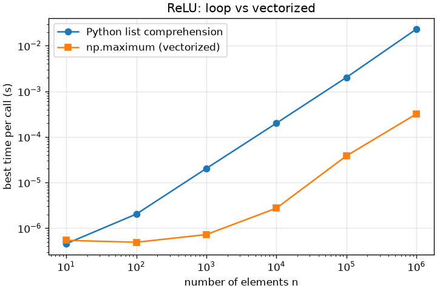

# Python and NumPy for ML

> **Level 0 · Module 1** · Prerequisites: none · Time: 5 to 6 hours · Code: `code/L0-01-python-numpy-for-ml/`

## What you will be able to do

- Predict the shape, dtype and memory cost of an array expression, and say whether a result is a view or a copy.
- Apply broadcasting rules by hand, and catch the shape bugs that broadcasting hides instead of reporting.
- Replace Python loops with vectorized NumPy, and measure the speedup honestly with `timeit` and `cProfile`.
- Make experiments reproducible with explicit random generators.
- Recognize overflow, underflow, cancellation and accumulation error, and derive and implement a stable log-sum-exp and softmax.
- Make a clear, labeled plot with Matplotlib's object-oriented interface.

## 1. Why ML code is written with arrays

Most ML computation is one small operation applied to many numbers: subtract a mean from a million values, multiply a batch by a weight matrix, exponentiate ten thousand logits. Plain Python can do this, slowly. Each Python float is a full heap object: on this module's machine `sys.getsizeof(1.0)` is 24 bytes for an 8-byte number, and a list of a million floats took 30.9 MiB against 7.6 MiB for a NumPy array (script 01). A loop over that list also checks types, dispatches `*` and allocates a result object for every element.

A NumPy `ndarray` is one block of raw, same-typed memory plus a small header describing it. Operations run as compiled loops over that memory, and the interpreter is involved once per operation instead of once per element. Harris et al. (2020) describe this array programming model and NumPy's role as the foundation of the scientific Python stack [Harris et al., 2020]. PyTorch tensors follow nearly the same rules, so this transfers directly to L2-02.

## 2. Shape, dtype, strides and memory

Check three facts first when something goes wrong:

- **Shape:** sizes per axis. A batch of 32 RGB 28 by 28 images might be `(32, 3, 28, 28)`.
- **dtype:** the element type shared by all elements: `float64`, `float32`, `int64`, `uint8`, `bool`.
- **Strides:** bytes to step in memory to move one position along each axis.

Strides explain why some operations are free. A `(3, 4)` `int64` array has strides `(32, 8)`. Its transpose reuses the same memory with strides `(8, 32)`: only the header changed. Basic slicing and most reshapes work the same way, while `astype(np.float32)` must allocate new memory because the bytes change.

Memory is `size * itemsize`. A 100-million-parameter model in float32 needs 400 MB for weights alone, before gradients and optimizer state (L4-02), so dtype is a design decision.

**Integers wrap silently** in array arithmetic. `int8` holds -128 to 127, so `120 + 10` gives `-126`; images often arrive as `uint8`, where `250 + 10` gives `4`. Widen the type first.

**Floats have limited precision.** Machine epsilon (the gap between 1.0 and the next float) is about $1.2 \times 10^{-7}$ for float32 and $2.2 \times 10^{-16}$ for float64, so float32 keeps about 7 significant digits. At $2^{24} = 16{,}777{,}216$ consecutive float32 values are 2 apart, and adding 1 does nothing.

## 3. Indexing: views, copies, masks and gathers

**Basic indexing** (integers, slices, `...`, `None`) always returns a **view** sharing memory with the original [NumPy indexing docs]. Writing into `row = X[1]` changes `X`. A small slice also keeps a large original alive; call `.copy()` if you only need the slice.

**Advanced indexing** (integer or boolean arrays) always returns a **copy**. Two patterns are everywhere in ML:

- **Boolean masks:** `scores[scores > 0.5]`.
- **Integer gathers:** `probs[np.arange(n), labels]` picks, for each row $i$, column `labels[i]`, which is exactly how cross-entropy pulls out the probability of the true class. The same trick with assignment builds one-hot vectors.

One trap: with repeated indices, `counts[idx] += 1` adds once per unique index, because the right side is computed on a temporary copy and assigned back [NumPy indexing docs]. For accumulation (histograms, gradients into embedding rows) use `np.add.at` or `np.bincount`. Script 02 shows `[1, 0, 1]` versus `[3, 0, 1]`.

## 4. Broadcasting

Broadcasting combines arrays of different shapes without copying [NumPy broadcasting docs]:

1. Align shapes from the **right**. Missing leading axes count as size 1.
2. Sizes are compatible if equal or if one is 1, which is then stretched. Otherwise NumPy raises `ValueError`.

Standardizing columns works directly: `X` is `(1000, 3)`, `mu = X.mean(axis=0)` is `(3,)`, treated as `(1, 3)`, and `X - mu` is `(1000, 3)`. Subtracting row means fails: `X.mean(axis=1)` is `(1000,)`, and its 1000 meets the 3. `keepdims=True` gives `(1000, 1)`, which works.

Inserting size-1 axes builds all-pairs computations. For `A` of shape `(n, d)` and `B` of shape `(m, d)`, `A[:, None, :] - B[None, :, :]` is `(n, m, d)`, every pairwise difference; summing squares over the last axis gives all squared distances. Nearest neighbors, kernels and attention scores (L2-05) use this pattern.

The danger is that some shape mistakes become wrong numbers instead of errors. With targets of shape `(n,)` and predictions of shape `(n, 1)`, `y_true - y_pred` is `(n, n)`. In script 02 the correct MSE is 0.02 and the buggy one 1.42, with no warning. Assert shapes at function boundaries: `assert y_pred.shape == y_true.shape`.

## 5. Vectorization and how to measure it

**Vectorization** means writing computations as whole-array operations so the per-element loop runs in compiled code. Script 03 on this module's machine (Intel Core i7-13700HX, WSL2, NumPy 2.5.4 with OpenBLAS):

| Kernel | Python loop | NumPy | Speedup |
|---|---|---|---|
| Sum of squares, $10^6$ values | 17.38 ms | 0.014 ms | about 1250x |
| ReLU, $10^6$ values | 37.36 ms | 0.299 ms | about 125x |
| Pairwise distances, 300 x 300 points, 64 dims | 80.28 ms | 0.290 ms | about 280x |

A single "NumPy is N times faster" hides a lot. The sum of squares calls `np.dot`, an optimized BLAS routine that can use several cores and vector instructions. The ReLU is elementwise, mostly limited by memory bandwidth, and writes a new array. The pairwise-distance "loop" already uses NumPy per pair; its time is mostly Python overhead, which is typical of half-vectorized code. And script 06 shows that at $n = 10$ loop and NumPy both take about half a microsecond, because each NumPy call has a fixed overhead; the ratio reaches roughly 50x to 75x only from about $n = 10^4$ upward. Vectorizing a 10-item loop gains nothing.

Vectorization also costs memory. The broadcast pairwise form materializes an `(n, m, d)` temporary (44 MiB here, gigabytes at realistic sizes). The identity $\lVert a - b\rVert^2 = \lVert a\rVert^2 - 2a\cdot b + \lVert b\rVert^2$ needs only `(n, m)` memory and turns the work into a matrix product (L0-02), at some cost in precision for nearly identical points.

**Measuring honestly.** Use `timeit` and report the **minimum** of repeated runs; the Python documentation explains that slower runs usually reflect interference from other processes, not your code [Python timeit docs]. Assert that the fast and slow versions agree before timing. And check the machine is quiet: while this module was being written, another job on the same machine made a 256 by 256 matrix product (L0-02, script 02) take 50 ms instead of about 0.12 ms.

## 6. Reproducibility: seeds and generators

A **pseudo-random number generator** produces a deterministic sequence that looks random; the **seed** picks the starting point. NumPy recommends `rng = np.random.default_rng(seed)`, a `Generator` backed by PCG64, over the legacy global functions such as `np.random.seed` [NumPy random docs]. Script 04 shows why:

- **A stream depends on every earlier draw.** One extra draw before initializing weights turns `[0.3047, -1.04, 0.7505]` into `[-1.04, 0.7505, 0.9406]`. Adding an augmentation can silently change initialization.
- **Global state is shared.** With the legacy API, any imported library that calls `np.random.*` moves your stream: a seeded value changed from 0.5488 to 0.7152 because "someone else" drew first.
- **Independent streams fix this.** `rng.spawn(k)` derives $k$ independent child generators. Give one each to initialization, data loading and dropout.

Create one root generator from a seed, pass generators explicitly into functions, and record the seed with your results. Two limits: NumPy does not guarantee identical streams across versions [NumPy random docs], so record versions too; and seeding NumPy does not seed Python's `random` or PyTorch (L2-02). Multithreaded libraries can also differ run to run in the last bits, because the order of floating-point additions changes the result.

## 7. Floating point: what can go wrong

A float stores a sign, a fixed number of significant bits and an exponent: scientific notation in base 2. IEEE 754 float64 has 53 significant bits and float32 has 24. Goldberg (1991) is the classic account of the consequences; the Python tutorial is a short practical one [Goldberg, 1991; Python floating-point tutorial].

**Rounding.** Most decimals are not exact in binary: `0.1 + 0.2` is `0.30000000000000004`. Compare with `np.isclose`, never `==`. Each operation's relative error is at most about $\text{eps}/2$, and errors accumulate.

**Overflow.** float64 tops out near $1.8 \times 10^{308}$, so `exp(710)` is `inf`; in float32 (max near $3.4 \times 10^{38}$) `exp(89)` already overflows. Then `inf / inf` is `nan`, which spreads through everything it touches.

**Underflow.** `exp(-746)` is 0 in float64 and `exp(-104)` is 0 in float32. Below the smallest normal number (about $1.2 \times 10^{-38}$ in float32) lie **subnormal** numbers with fewer significant bits. Since ML takes logs of probabilities and $\log 0 = -\infty$, likelihoods are computed as sums of logs: a product of 1,000 probabilities of 0.01 is $10^{-2000}$, zero in any format.

**Cancellation.** Subtracting nearly equal numbers loses their shared digits. The formula $\mathrm{Var}(x) = \mathbb{E}[x^2] - (\mathbb{E}[x])^2$ is exact algebra but fails when the mean is large relative to the spread. In script 05, data with mean $10^8$ and variance near 1 give 2.0000 by this formula and 0.9962 by the two-pass method (subtract the mean, then square) and `np.var`. Both terms are about $10^{16}$, where float64 cannot resolve a difference of 1.

**Accumulation.** A float32 running total of 2 million copies of 0.1 reached 197,024.8 instead of 200,000.0, a 1.5% error, because each tiny addend loses its low bits against a large total. `np.sum` uses pairwise summation, adding in a tree so partial sums stay similar in size; over ten million float32 values its error was 0.11 in $10^6$. Accumulating in float64 or with `math.fsum` gave the exact answer. This is why mixed-precision training keeps some accumulations in higher precision (L4-02).

## 8. Log-sum-exp and a stable softmax

The **softmax** maps logits $z \in \mathbb{R}^K$ to probabilities, and its log needs **log-sum-exp**:

$$\mathrm{softmax}(z)_i = \frac{e^{z_i}}{\sum_{j=1}^{K} e^{z_j}}, \qquad \mathrm{LSE}(z) = \log \sum_{j=1}^{K} e^{z_j}, \qquad \log \mathrm{softmax}(z)_i = z_i - \mathrm{LSE}(z).$$

Evaluated directly, both break. For $z = (1000, 1001, 1002)$ every exponential overflows, LSE is `inf` and softmax is `nan`. For $z = (-1000, -1001, -1002)$ every exponential underflows, LSE is $-\infty$ and softmax is `0/0 = nan`. Yet the answers are ordinary: these are $(1, 2, 3)$ shifted by a constant.

That is the fix. For any constant $c$,

$$\sum_j e^{z_j} = e^{c} \sum_j e^{z_j - c} \;\Longrightarrow\; \mathrm{LSE}(z) = c + \log \sum_j e^{z_j - c},$$

and $e^{c}$ cancels in the softmax ratio, so $\mathrm{softmax}(z) = \mathrm{softmax}(z - c)$. Choose $c = \max_j z_j$. Every exponent is then at most 0, so nothing overflows, and one term is exactly $e^0 = 1$, so the sum is at least 1 and its log is finite. Terms far below the maximum may underflow, but they would contribute less than rounding error anyway. Blanchard, Higham and Higham analyze the rounding error of this shifted algorithm and find its accuracy similar to the unshifted formula's, with the division-based shifted softmax usually more accurate than a division-free alternative [Blanchard et al., 2021]. Use a library routine such as `scipy.special.logsumexp` (deep learning frameworks have equivalents, see L2-02), but know what it does.

**Compute losses from logits, not probabilities.** In script 05 the logits $(50, 0, -50)$ give the last class probability about $3.7 \times 10^{-44}$. In float64 `log(softmax)` still returns $-100$, but in float32 that probability is subnormal and its log comes out as $-99.983$; slightly larger logits make it exactly 0, its log $-\infty$, and training produces `nan`. The form $z_i - \mathrm{LSE}(z)$ gives $-100$ with no tiny intermediate. That is why frameworks provide fused cross-entropy-from-logits losses.

## 9. Profiling and plotting

**Profile before optimizing.** `cProfile` records every function call: run `python -m cProfile -s cumulative script.py`, or call it from code as script 06 does [Python profile docs]. `tottime` is time inside a function excluding its callees; `cumtime` includes them. Sort by `cumtime` to find the expensive step, then use `tottime` to find where the work happens. (As of the Python 3.15 documentation, October 2026, `cProfile` is kept as an alias of a new `profiling.tracing` module; this module uses Python 3.12.)

In script 06, a toy pipeline takes 0.157 s, of which 0.139 s is `tottime` in `clip_outliers_slow`, a double Python loop over a 50,000 by 20 array. Replacing it with `np.clip` drops the pipeline to 0.017 s, and data generation becomes the largest cost. Profile, fix the biggest item, profile again, stop when nothing dominates.

**Plotting.** Matplotlib's implicit `plt.plot(...)` style suits quick interactive work; the documentation recommends the explicit style, creating a `Figure` and `Axes` and calling methods on them, for scripts and reusable code [Matplotlib quick start]. Use `fig, ax = plt.subplots()`, label axes with units, add a legend for multiple lines, and use log scales when values span orders of magnitude. Without a display, call `matplotlib.use("Agg")` and `fig.savefig`. Script 06 produces:



On log-log axes, cost proportional to $n$ is a line of slope 1. The loop follows it throughout. NumPy is flat below about 1,000 elements, where per-call overhead dominates, then runs roughly parallel to the loop. The vertical gap is the constant-factor speedup.

## Hands-on

Run each script from the repository root, for example `.venv/bin/python code/L0-01-python-numpy-for-ml/01_arrays_and_dtypes.py`. Outputs come from Python 3.12.3 and NumPy 2.5.4 on Linux (WSL2). Timings will differ on your machine; floating-point results should match closely, though last digits can vary with platform and BLAS build.

### Script 01: arrays, dtypes, views and copies

```python
"""Arrays, shapes, dtypes, memory, and views vs copies."""
import sys

import numpy as np

# 0. A Python float is a full object; a NumPy float64 element is 8 raw bytes.
lst = [float(i) for i in range(1_000_000)]
list_bytes = sys.getsizeof(lst) + sum(sys.getsizeof(v) for v in lst)
print(f"one Python float object: {sys.getsizeof(1.0)} bytes")
print(f"list of 1e6 floats: {list_bytes / 2**20:.1f} MiB | "
      f"np.float64 array: {np.array(lst).nbytes / 2**20:.1f} MiB\n")


def show(name, a):
    print(f"{name:<10} shape={a.shape!s:<10} dtype={a.dtype!s:<8} "
          f"nbytes={a.nbytes:<6} strides={a.strides}")


# 1. Shape and dtype are the two facts you check first about any array.
x = np.arange(12)                      # default integer dtype is int64 on Linux/macOS
m = x.reshape(3, 4)                    # same 12 numbers, viewed as 3 rows of 4
f32 = m.astype(np.float32)             # a real conversion: new memory
show("x", x)
show("m", m)
show("f32", f32)
show("m.T", m.T)                       # transpose only swaps strides, no copy

# 2. Views share memory with the original; copies do not.
row = m[1]                             # basic indexing -> view
row[0] = 100
print("\nafter row[0] = 100, m[1] =", m[1], "| shares memory:", np.shares_memory(row, m))
picked = m[[0, 2]]                     # integer-array (advanced) indexing -> copy
picked[0, 0] = -1
print("after picked[0,0] = -1, m[0,0] =", m[0, 0], "| shares memory:",
      np.shares_memory(picked, m))

# 3. Integer overflow wraps silently for array arithmetic.
small = np.array([100, 120], dtype=np.int8)   # int8 holds -128..127
print("\nint8 [100, 120] + 10 =", small + np.int8(10))
pix = np.array([200, 250], dtype=np.uint8)    # typical image dtype
print("uint8 [200, 250] + 10 =", pix + np.uint8(10))
print("same sum after casting to int16 =", pix.astype(np.int16) + 10)

# 4. Float precision: float32 has about 7 significant decimal digits.
for dt in (np.float16, np.float32, np.float64):
    info = np.finfo(dt)
    print(f"{dt.__name__:<8} eps={info.eps:.3e}  max={info.max:.3e}  "
          f"smallest normal={info.smallest_normal:.3e}")
big = np.float32(16_777_216)                  # 2**24
print("float32: 2**24 + 1 =", big + np.float32(1), "(the +1 is lost)")
```

```text
one Python float object: 24 bytes
list of 1e6 floats: 30.9 MiB | np.float64 array: 7.6 MiB

x          shape=(12,)      dtype=int64    nbytes=96     strides=(8,)
m          shape=(3, 4)     dtype=int64    nbytes=96     strides=(32, 8)
f32        shape=(3, 4)     dtype=float32  nbytes=48     strides=(16, 4)
m.T        shape=(4, 3)     dtype=int64    nbytes=96     strides=(8, 32)

after row[0] = 100, m[1] = [100   5   6   7] | shares memory: True
after picked[0,0] = -1, m[0,0] = 0 | shares memory: False

int8 [100, 120] + 10 = [ 110 -126]
uint8 [200, 250] + 10 = [210   4]
same sum after casting to int16 = [210 260]
float16  eps=9.766e-04  max=6.550e+04  smallest normal=6.104e-05
float32  eps=1.192e-07  max=3.403e+38  smallest normal=1.175e-38
float64  eps=2.220e-16  max=1.798e+308  smallest normal=2.225e-308
float32: 2**24 + 1 = 1.6777216e+07 (the +1 is lost)
```

### Script 02: broadcasting and indexing

```python
"""Broadcasting and indexing patterns that show up in every ML codebase."""
import numpy as np

rng = np.random.default_rng(0)

# 1. Standardize features: (n, d) minus (d,) broadcasts over rows.
X = rng.normal(loc=[0.0, 5.0, -3.0], scale=[1.0, 10.0, 0.1], size=(1000, 3))
mu = X.mean(axis=0)                      # shape (3,)
sd = X.std(axis=0)                       # shape (3,)
Z = (X - mu) / sd                        # (1000,3) op (3,) -> (1000,3)
print("column means after standardizing:", np.round(Z.mean(axis=0), 6))
print("column stds  after standardizing:", np.round(Z.std(axis=0), 6))

# 2. The classic bug: subtracting per-ROW statistics needs keepdims.
row_mean = X.mean(axis=1)                # shape (1000,)
try:
    X - row_mean                         # (1000,3) vs (1000,) -> trailing dims 3 vs 1000
except ValueError as e:
    print("\nwithout keepdims:", e)
centered = X - X.mean(axis=1, keepdims=True)   # (1000,3) - (1000,1) works
print("with keepdims, row means are now ~0:", np.abs(centered.mean(axis=1)).max() < 1e-12)

# 3. Pairwise squared distances between n queries and m keys with no loop.
#    ||a - b||^2 = ||a||^2 - 2 a.b + ||b||^2, each term broadcast to (n, m).
A = rng.normal(size=(4, 3))
B = rng.normal(size=(5, 3))
d2_bcast = ((A[:, None, :] - B[None, :, :]) ** 2).sum(axis=-1)     # (4,1,3)-(1,5,3)
d2_expand = (A**2).sum(1)[:, None] - 2 * A @ B.T + (B**2).sum(1)[None, :]
print("\npairwise distance shape:", d2_bcast.shape,
      "| two methods agree:", np.allclose(d2_bcast, d2_expand))

# 4. A silent broadcasting bug: (n,) vs (n,1) gives an (n,n) matrix, not an error.
y_true = np.array([1.0, 2.0, 3.0])          # shape (3,)
y_pred = np.array([[1.1], [1.9], [3.2]])    # shape (3,1), e.g. output of a model
wrong = ((y_true - y_pred) ** 2).mean()
right = ((y_true - y_pred.ravel()) ** 2).mean()
print(f"\nMSE with shape bug: {wrong:.4f}  (diff shape {(y_true - y_pred).shape})")
print(f"MSE correct:        {right:.4f}")

# 5. Boolean masks and integer ("fancy") indexing.
scores = np.array([0.2, 0.9, 0.4, 0.75, 0.1])
print("\nmask scores > 0.5:", scores > 0.5, "->", scores[scores > 0.5])

# 6. One-hot encoding via fancy indexing, and gathering per-row entries.
labels = np.array([2, 0, 1, 2])
onehot = np.zeros((labels.size, 3))
onehot[np.arange(labels.size), labels] = 1.0
print("one-hot:\n", onehot)
probs = rng.dirichlet(np.ones(3), size=4)    # each row sums to 1
p_correct = probs[np.arange(4), labels]      # probability of the true class per row
print("prob of true class:", np.round(p_correct, 3))

# 7. Repeated indices: += applies once per unique index, np.add.at accumulates.
counts = np.zeros(3)
idx = np.array([0, 0, 0, 2])
counts[idx] += 1
print("\ncounts[idx] += 1  ->", counts)
counts = np.zeros(3)
np.add.at(counts, idx, 1)
print("np.add.at          ->", counts)
print("np.bincount        ->", np.bincount(idx, minlength=3))
```

```text
column means after standardizing: [ 0. -0. -0.]
column stds  after standardizing: [1. 1. 1.]

without keepdims: operands could not be broadcast together with shapes (1000,3) (1000,) 
with keepdims, row means are now ~0: True

pairwise distance shape: (4, 5) | two methods agree: True

MSE with shape bug: 1.4200  (diff shape (3, 3))
MSE correct:        0.0200

mask scores > 0.5: [False  True False  True False] -> [0.9  0.75]
one-hot:
 [[0. 0. 1.]
 [1. 0. 0.]
 [0. 1. 0.]
 [0. 0. 1.]]
prob of true class: [0.197 0.1   0.26  0.056]

counts[idx] += 1  -> [1. 0. 1.]
np.add.at          -> [3. 0. 1.]
np.bincount        -> [3 0 1]
```

The `-0.` entries are tiny negative numbers (around $10^{-17}$) rounded for display.

### Script 03: vectorization timings

```python
"""Measure loops vs vectorized NumPy on three typical ML kernels.

Timings depend on your CPU, BLAS library, and machine load. Ratios are more
portable than absolute numbers, and even ratios vary.
"""
import timeit

import numpy as np

rng = np.random.default_rng(0)


def best_time(fn, repeat=5, number=1):
    """Best of `repeat` runs, in seconds per call (timeit docs recommend the min)."""
    return min(timeit.repeat(fn, repeat=repeat, number=number)) / number


# Kernel 1: sum of squares (a reduction).
x = rng.normal(size=1_000_000)
x_list = x.tolist()


def sumsq_loop():
    s = 0.0
    for v in x_list:
        s += v * v
    return s


def sumsq_numpy():
    return np.dot(x, x)


# Kernel 2: ReLU applied elementwise.
def relu_loop():
    return [v if v > 0 else 0.0 for v in x_list]


def relu_numpy():
    return np.maximum(x, 0.0)


# Kernel 3: pairwise squared distances, 300 x 300 points in 64 dimensions.
P = rng.normal(size=(300, 64))
Q = rng.normal(size=(300, 64))


def dist_loop():
    n, m = len(P), len(Q)
    out = np.empty((n, m))
    for i in range(n):
        for j in range(m):
            diff = P[i] - Q[j]           # still uses NumPy for the inner vector
            out[i, j] = diff @ diff
    return out


def dist_numpy():
    return (P**2).sum(1)[:, None] - 2 * P @ Q.T + (Q**2).sum(1)[None, :]


# Check the fast versions give the same answers before timing anything.
assert np.isclose(sumsq_loop(), sumsq_numpy())
assert np.allclose(relu_loop(), relu_numpy())
assert np.allclose(dist_loop(), dist_numpy())

print(f"{'kernel':<28}{'loop (ms)':>12}{'numpy (ms)':>12}{'speedup':>10}")
for name, slow, fast, rep in [
    ("sum of squares, n=1e6", sumsq_loop, sumsq_numpy, 3),
    ("ReLU, n=1e6", relu_loop, relu_numpy, 3),
    ("pairwise dist 300x300x64", dist_loop, dist_numpy, 3),
]:
    t_slow = best_time(slow, repeat=rep)
    t_fast = best_time(fast, repeat=20)
    print(f"{name:<28}{t_slow*1e3:>12.2f}{t_fast*1e3:>12.3f}{t_slow/t_fast:>10.0f}x")

# Vectorization is not free: a temporary array costs memory. The broadcast
# version of pairwise distance materializes an (n, m, d) array.
n, m, d = 300, 300, 64
print(f"\nbroadcast temp (n,m,d) float64 = {n*m*d*8/2**20:.0f} MiB; "
      f"expanded form temp (n,m) = {n*m*8/2**20:.1f} MiB")
```

```text
kernel                         loop (ms)  numpy (ms)   speedup
sum of squares, n=1e6              17.38       0.014      1252x
ReLU, n=1e6                        37.36       0.299       125x
pairwise dist 300x300x64           80.28       0.290       277x

broadcast temp (n,m,d) float64 = 44 MiB; expanded form temp (n,m) = 0.7 MiB
```

### Script 04: reproducibility

```python
"""Seeds and random number generators: what makes a run reproducible."""
import numpy as np

# 1. Same seed -> same stream. Different seed -> different stream.
a = np.random.default_rng(42).normal(size=3)
b = np.random.default_rng(42).normal(size=3)
c = np.random.default_rng(43).normal(size=3)
print("seed 42:", np.round(a, 4))
print("seed 42:", np.round(b, 4), "| identical:", np.array_equal(a, b))
print("seed 43:", np.round(c, 4))

# 2. A stream depends on everything drawn before. Inserting one extra draw
#    shifts every later number, which is why "I only added a print" can
#    change your results if that code also touches the RNG.
rng = np.random.default_rng(42)
init_w = rng.normal(size=3)
rng2 = np.random.default_rng(42)
_ = rng2.random()                  # one extra draw, e.g. a new augmentation
init_w2 = rng2.normal(size=3)
print("\nweights, clean run:       ", np.round(init_w, 4))
print("weights, one extra draw:  ", np.round(init_w2, 4))

# 3. Give each component its own generator so changes stay local.
#    spawn() derives statistically independent child streams from one seed.
root = np.random.default_rng(42)
rng_init, rng_data, rng_dropout = root.spawn(3)
w = rng_init.normal(size=3)
_ = rng_data.permutation(10)       # extra draws here...
_ = rng_data.random(1000)
w_again = np.random.default_rng(42).spawn(3)[0].normal(size=3)
print("\ninit stream unaffected by data stream:", np.array_equal(w, w_again))


# 4. Pass generators into functions instead of using hidden global state.
def train_test_split(n, test_frac, rng):
    idx = rng.permutation(n)
    k = int(n * test_frac)
    return idx[k:], idx[:k]


tr, te = train_test_split(10, 0.3, np.random.default_rng(7))
print("\nsplit with seed 7: train", tr, "test", te)

# 5. Legacy global API still exists and still works, but it is shared state:
#    any library that calls np.random.* moves the same stream.
np.random.seed(0)
first = np.random.rand()
np.random.seed(0)
np.random.rand()                   # pretend a library you imported did this
second = np.random.rand()
print(f"\nlegacy global: {first:.4f} vs {second:.4f} (changed by someone else's draw)")
```

```text
seed 42: [ 0.3047 -1.04    0.7505]
seed 42: [ 0.3047 -1.04    0.7505] | identical: True
seed 43: [ 0.2442  0.6782 -0.5855]

weights, clean run:        [ 0.3047 -1.04    0.7505]
weights, one extra draw:   [-1.04    0.7505  0.9406]

init stream unaffected by data stream: True

split with seed 7: train [1 3 6 2 4 5 9] test [8 0 7]

legacy global: 0.5488 vs 0.7152 (changed by someone else's draw)
```

### Script 05: floating-point pitfalls

```python
"""Floating-point pitfalls: rounding, overflow, underflow, cancellation, log-sum-exp."""
import math

import numpy as np
from scipy.special import logsumexp as scipy_lse

np.seterr(all="ignore")   # we want to SEE inf/nan here, not warnings

# 1. Decimal fractions are not exact in binary.
print("0.1 + 0.2 == 0.3 ?", 0.1 + 0.2 == 0.3, "| value:", repr(0.1 + 0.2))
print("np.isclose(0.1 + 0.2, 0.3):", np.isclose(0.1 + 0.2, 0.3))

# 2. Overflow and underflow of exp in float64 and float32.
for dt in (np.float64, np.float32):
    print(f"{dt.__name__}: exp(710)={np.exp(dt(710))}, exp(89)={np.exp(dt(89))}, "
          f"exp(-746)={np.exp(dt(-746))}, exp(-104)={np.exp(dt(-104))}")


# 3. Naive vs shifted log-sum-exp and softmax.
def lse_naive(z):
    return np.log(np.sum(np.exp(z)))


def lse_stable(z):
    m = np.max(z)
    return m + np.log(np.sum(np.exp(z - m)))   # every exponent is <= 0


def softmax_naive(z):
    e = np.exp(z)
    return e / e.sum()


def softmax_stable(z):
    e = np.exp(z - np.max(z))
    return e / e.sum()


for z in (np.array([1.0, 2.0, 3.0]),
          np.array([1000.0, 1001.0, 1002.0]),
          np.array([-1000.0, -1001.0, -1002.0])):
    print(f"\nz={z}")
    print(f"  naive lse={lse_naive(z)!s:<20} stable lse={lse_stable(z):.6f}  "
          f"scipy={scipy_lse(z):.6f}")
    print(f"  naive softmax={softmax_naive(z)}  stable={np.round(softmax_stable(z), 6)}")

# 4. Cross-entropy from logits: never take log of a softmax that rounded to 0.
logits = np.array([50.0, 0.0, -50.0])
true_class = 2
p = softmax_stable(logits)
print(f"\nlog(softmax)[2] = {np.log(p[true_class])}  (p rounds to {p[true_class]:.3e})")
print(f"log-softmax via lse = {logits[true_class] - lse_stable(logits):.4f}")
p32 = softmax_stable(logits.astype(np.float32))
print(f"same in float32: log(p) = {np.log(p32[true_class])}")

# 5. Catastrophic cancellation: the one-pass variance formula E[x^2] - E[x]^2.
rng = np.random.default_rng(0)
x = 1e8 + rng.normal(size=10_000)      # true variance ~1, huge mean
one_pass = np.mean(x**2) - np.mean(x) ** 2
two_pass = np.mean((x - x.mean()) ** 2)
print(f"\nvariance one-pass={one_pass:.4f}  two-pass={two_pass:.4f}  np.var={np.var(x):.4f}")

# 6. Accumulating many small numbers in float32.
#    np.sum uses pairwise summation, so its error grows slowly; a running
#    total in float32 stalls once it is so large that adding 0.1 rounds away.
vals = np.full(10_000_000, 0.1, dtype=np.float32)
loop32 = np.float32(0.0)
for v in vals[:2_000_000]:             # strictly one-at-a-time, 2e6 terms
    loop32 += v
exact = 10_000_000 * float(np.float32(0.1))   # float32(0.1) is 0.10000000149...
print(f"\nsum of 1e7 copies of float32(0.1), exact {exact:.3f}:")
print(f"  float32 np.sum={vals.sum():.3f}  float64 accumulate="
      f"{vals.sum(dtype=np.float64):.3f}  math.fsum={math.fsum(vals):.3f}")
print(f"one-at-a-time float32 running total over 2e6 terms "
      f"(exact {exact / 5:.3f}): {loop32:.3f}")

# 7. NaN propagates, and NaN != NaN.
y = np.array([1.0, np.nan, 3.0])
print(f"\nmean with nan={y.mean()}, nanmean={np.nanmean(y)}, nan==nan: {np.nan == np.nan}")
```

```text
0.1 + 0.2 == 0.3 ? False | value: 0.30000000000000004
np.isclose(0.1 + 0.2, 0.3): True
float64: exp(710)=inf, exp(89)=4.4896128191743455e+38, exp(-746)=0.0, exp(-104)=6.813556821545298e-46
float32: exp(710)=inf, exp(89)=inf, exp(-746)=0.0, exp(-104)=0.0

z=[1. 2. 3.]
  naive lse=3.40760596444438     stable lse=3.407606  scipy=3.407606
  naive softmax=[0.09003057 0.24472847 0.66524096]  stable=[0.090031 0.244728 0.665241]

z=[1000. 1001. 1002.]
  naive lse=inf                  stable lse=1002.407606  scipy=1002.407606
  naive softmax=[nan nan nan]  stable=[0.090031 0.244728 0.665241]

z=[-1000. -1001. -1002.]
  naive lse=-inf                 stable lse=-999.592394  scipy=-999.592394
  naive softmax=[nan nan nan]  stable=[0.665241 0.244728 0.090031]

log(softmax)[2] = -100.0  (p rounds to 3.720e-44)
log-softmax via lse = -100.0000
same in float32: log(p) = -99.98309326171875

variance one-pass=2.0000  two-pass=0.9962  np.var=0.9962

sum of 1e7 copies of float32(0.1), exact 1000000.015:
  float32 np.sum=1000000.125  float64 accumulate=1000000.015  math.fsum=1000000.015
one-at-a-time float32 running total over 2e6 terms (exact 200000.003): 197024.781

mean with nan=nan, nanmean=2.0, nan==nan: False
```

### Script 06: profiling and plotting

```python
"""Profile a small pipeline with cProfile, then plot loop vs NumPy scaling.

Run from the repository root so the plot lands in docs/assets/.
"""
import cProfile
import io
import pstats
import time
from pathlib import Path

import matplotlib
matplotlib.use("Agg")                   # no display needed; write a file
import matplotlib.pyplot as plt
import numpy as np

rng = np.random.default_rng(0)
OUT = Path("docs/assets/L0-01-python-numpy-for-ml")


# A toy "feature pipeline" with one deliberately slow step.
def load(n):
    return rng.normal(size=(n, 20))


def standardize(X):
    return (X - X.mean(0)) / X.std(0)


def clip_outliers_slow(X, k=3.0):
    out = X.copy()
    for i in range(out.shape[0]):       # Python loop over rows: the bottleneck
        for j in range(out.shape[1]):
            if out[i, j] > k:
                out[i, j] = k
            elif out[i, j] < -k:
                out[i, j] = -k
    return out


def clip_outliers_fast(X, k=3.0):
    return np.clip(X, -k, k)


def pipeline(clip):
    X = load(50_000)
    Z = standardize(X)
    return clip(Z).sum()


def profile(fn, *args):
    pr = cProfile.Profile()
    pr.enable()
    fn(*args)
    pr.disable()
    s = io.StringIO()
    # Keep only our own functions in the report so it stays readable.
    st = pstats.Stats(pr, stream=s).strip_dirs().sort_stats("cumulative")
    st.print_stats(r"06_profile_and_plot")
    lines = [ln for ln in s.getvalue().splitlines() if ln.strip()]
    print("\n".join(ln for ln in lines if "List reduced" not in ln))


print("=== profile: slow clip ===")
profile(pipeline, clip_outliers_slow)
print("\n=== profile: fast clip ===")
profile(pipeline, clip_outliers_fast)
Xc = rng.normal(size=(1000, 20)) * 2
assert np.array_equal(clip_outliers_slow(Xc), clip_outliers_fast(Xc))  # same result


# Scaling plot: time per call vs n for loop and NumPy ReLU.
def timed(fn, *args, repeat=3):
    best = float("inf")
    for _ in range(repeat):
        t0 = time.perf_counter()
        fn(*args)
        best = min(best, time.perf_counter() - t0)
    return best


sizes = np.logspace(1, 6, 6).astype(int)      # 10, 100, ..., 1,000,000
t_loop, t_np = [], []
for n in sizes:
    v = rng.normal(size=n)
    lst = v.tolist()
    t_loop.append(timed(lambda: [a if a > 0 else 0.0 for a in lst]))
    t_np.append(timed(lambda: np.maximum(v, 0.0)))

for n, a, b in zip(sizes, t_loop, t_np):
    print(f"n={n:>8}  loop={a*1e6:>10.1f} us  numpy={b*1e6:>8.1f} us  ratio={a/b:>6.1f}")

OUT.mkdir(parents=True, exist_ok=True)
fig, ax = plt.subplots(figsize=(6, 4), layout="constrained")
ax.loglog(sizes, t_loop, "o-", label="Python list comprehension")
ax.loglog(sizes, t_np, "s-", label="np.maximum (vectorized)")
ax.set_xlabel("number of elements n")
ax.set_ylabel("best time per call (s)")
ax.set_title("ReLU: loop vs vectorized")
ax.grid(True, which="major", alpha=0.3)
ax.legend()
fig.savefig(OUT / "relu_scaling.png", dpi=120)
print(f"saved {OUT / 'relu_scaling.png'}")
```

```text
=== profile: slow clip ===
         33 function calls in 0.157 seconds
   Ordered by: cumulative time
   ncalls  tottime  percall  cumtime  percall filename:lineno(function)
        1    0.000    0.000    0.157    0.157 06_profile_and_plot.py:44(pipeline)
        1    0.139    0.139    0.140    0.140 06_profile_and_plot.py:29(clip_outliers_slow)
        1    0.009    0.009    0.009    0.009 06_profile_and_plot.py:21(load)
        1    0.003    0.003    0.008    0.008 06_profile_and_plot.py:25(standardize)

=== profile: fast clip ===
         38 function calls in 0.017 seconds
   Ordered by: cumulative time
   ncalls  tottime  percall  cumtime  percall filename:lineno(function)
        1    0.000    0.000    0.017    0.017 06_profile_and_plot.py:44(pipeline)
        1    0.009    0.009    0.009    0.009 06_profile_and_plot.py:21(load)
        1    0.002    0.002    0.007    0.007 06_profile_and_plot.py:25(standardize)
        1    0.000    0.000    0.001    0.001 06_profile_and_plot.py:40(clip_outliers_fast)
n=      10  loop=       0.5 us  numpy=     0.5 us  ratio=   0.8
n=     100  loop=       2.0 us  numpy=     0.5 us  ratio=   4.1
n=    1000  loop=      20.3 us  numpy=     0.7 us  ratio=  28.1
n=   10000  loop=     200.1 us  numpy=     2.7 us  ratio=  73.1
n=  100000  loop=    2017.5 us  numpy=    38.4 us  ratio=  52.5
n= 1000000  loop=   23212.9 us  numpy=   319.9 us  ratio=  72.6
saved docs/assets/L0-01-python-numpy-for-ml/relu_scaling.png
```

## Common mistakes

- **Shapes that broadcast by accident.** `(n,)` against `(n, 1)` gives `(n, n)`. Symptom: a loss that is too large or will not fall. Assert shapes.
- **Mutating a view.** Normalizing a slice in place changes the dataset. Check `np.shares_memory`, or `.copy()`.
- **Integer arithmetic on images or counts.** `uint8` wraps at 255. Convert to float first.
- **Accidental float64.** NumPy defaults to float64, deep learning frameworks to float32. Mixing doubles memory or causes dtype errors. Check `.dtype`.
- **`+=` with repeated indices.** Applied once per unique index. Use `np.add.at` or `np.bincount`.
- **Timing the first call or a busy machine.** Take the minimum of repeats on a quiet machine.
- **Hidden global random state.** Results change when unrelated code is added. Pass `Generator` objects explicitly.
- **Exponentiating raw logits or taking `log` of a softmax.** Symptom: `inf` or `nan` in the loss, often only after logits grow. Use log-sum-exp and losses that take logits.
- **Comparing floats with `==`.** Use `np.isclose`.
- **Silent `nan`.** One `nan` makes `mean` return `nan`. Check `np.isnan(x).any()` at load time.

## Exercises

1. [warm-up] Give the result shape or say it is an error: `(5, 1) + (3,)`; `(4, 3) + (4,)`; `(2, 1, 6) * (7, 1)`; `(8, 4, 3) - (2, 1)`.
2. [warm-up] An embedding table is 50,000 by 768. How much memory in float32 and float16?
3. [warm-up] For `a = np.arange(10)` and `b = a[::2]`: is `b` a view, what are its strides, and what does `b[:] = 0` do to `a`?
4. [core] Write a stable `softmax(Z, axis=-1)` for 2D logits. Test on `[[1000, 1001], [-1000, -1001]]` and against `scipy.special.softmax`.
5. [core] Write a loop-free `cross_entropy(logits, labels)` using log-sum-exp and an integer gather. Check it gives $\log K$ for all-zero logits.
6. [core] Compute all pairwise cosine similarities between rows of `X` without a loop, and each row's most similar other row.
7. [core] Bootstrap a dataset's mean 1,000 times with a `Generator` argument. Show that equal seeds agree and that spawned streams keep the result unchanged when unrelated random calls are added.
8. [stretch] Implement Welford's one-pass variance and compare it with $\mathbb{E}[x^2] - \mathbb{E}[x]^2$ and `np.var` on `1e9 + rng.normal(size=10**5)` in float32 and float64.
9. [stretch] Write `logsumexp(a, axis)` that handles `-inf` entries, including an all `-inf` row, without `nan` warnings. What should an all `-inf` row return?
10. [stretch] Profile `dist_loop` from script 03 and use `tottime` to argue how much of its time is Python overhead.

### Hints and answers

1. `(5, 3)`; error (3 vs 4); `(2, 7, 6)`; error (4 vs 2 in the second-to-last axis).
2. $50{,}000 \times 768 \times 4 = 153.6$ MB (about 146.5 MiB) in float32, half in float16.
3. A view, strides `(16,)`, and the even positions of `a` become 0.
4. Subtract `Z.max(axis=axis, keepdims=True)` before `np.exp`. Rows come out near `[0.269, 0.731]` and `[0.731, 0.269]`.
5. `m = Z.max(1)`, `lse = m + np.log(np.exp(Z - m[:, None]).sum(1))`, loss `(lse - Z[np.arange(n), labels]).mean()`. Uniform probabilities $1/K$ give $\log K$.
6. Normalize rows, compute `Xn @ Xn.T`, `np.fill_diagonal(S, -np.inf)`, then `argmax(axis=1)`. L0-02 explains why this is the cosine.
7. Use `rng.integers(0, n, size=(1000, n))` and means along axis 1; separate streams via `root.spawn(2)`.
8. Welford updates a running mean and sum of squared deviations $M_2$; variance is $M_2/n$. The naive formula is useless in float32 at this offset, and float32 itself has spacing 64 near $10^9$, so even Welford is limited there.
9. If the max is `-inf`, `z - max` is `nan`; replace a non-finite max by 0 before shifting. An all `-inf` row should return `-inf`.
10. Script 03 spent about 80 ms on 90,000 pairs, under a microsecond each, about the fixed cost of a couple of tiny NumPy calls (the flat part of the section 9 plot). Overhead dominates.

## Check your understanding

1. **Why is `x.T` instant while `x.astype(np.float32)` takes time proportional to size?** The transpose only swaps shape and strides in the header, so the same bytes are read in a different order. A dtype change alters the bytes themselves, so NumPy must allocate and convert every element. Reinterpreting memory is cheap; changing it is not.

2. **Predictions are `(64, 1)`, targets `(64,)`, and the MSE barely falls. Why?** Broadcasting builds a `(64, 64)` matrix of every target minus every prediction, so the loss averages 4,096 mostly meaningless differences and pushes each prediction toward the mean of all targets. Make the shapes match and assert them.

3. **Why does subtracting the max make log-sum-exp safe without changing it?** Factoring $e^{c}$ out shows $\mathrm{LSE}(z) = c + \mathrm{LSE}(z - c)$ exactly. With $c = \max_j z_j$, no exponent is positive, so nothing overflows, and one term is 1, so the log is finite.

4. **You set a seed, but adding an augmentation changed your results. Why?** The augmentation drew from the same generator used later for initialization or dropout, shifting every later draw. A seed makes the program deterministic but not its parts independent. Give each component its own spawned stream, and record seeds and library versions.

5. **When is vectorizing not worth it?** When the loop is short (fixed per-call overhead dominates; there was no gain at 10 elements here), when the vectorized form needs a temporary too large for memory, or when the code is not the bottleneck, which only a profiler reveals.

## Further reading

- **Charles R. Harris, K. Jarrod Millman, Stéfan J. van der Walt, et al., "Array programming with NumPy"** (2020, Nature 585, 357 to 362; arXiv:2006.10256). https://www.nature.com/articles/s41586-020-2649-2
  *Read for:* the design of the ndarray (strides, views, broadcasting, vectorization) from NumPy's maintainers. Open access. *Level:* intro.
- **Jake VanderPlas, "Python Data Science Handbook"** (2016, O'Reilly; free online edition). https://jakevdp.github.io/PythonDataScienceHandbook/
  *Read for:* chapter 2, a gentle tour of arrays, ufuncs, aggregations, broadcasting, masks and fancy indexing. *Level:* intro.
- **NumPy Developers, "Broadcasting"** (NumPy v2.5 user guide, accessed October 2026). https://numpy.org/doc/stable/user/basics.broadcasting.html
  *Read for:* the authoritative broadcasting rules with examples of compatible and incompatible shapes. *Level:* intro.
- **NumPy Developers, "Indexing on ndarrays"** (NumPy v2.5 user guide, accessed October 2026). https://numpy.org/doc/stable/user/basics.indexing.html
  *Read for:* exactly when indexing returns a view or a copy, and repeated-index assignment. *Level:* intermediate.
- **NumPy Developers, "Random Generator"** (NumPy v2.5 reference, accessed October 2026). https://numpy.org/doc/stable/reference/random/generator.html
  *Read for:* `default_rng`, PCG64, and the lack of a cross-version stream guarantee. *Level:* intro.
- **David Goldberg, "What Every Computer Scientist Should Know About Floating-Point Arithmetic"** (1991, ACM Computing Surveys 23(1)). https://docs.oracle.com/cd/E19957-01/806-3568/ncg_goldberg.html
  *Read for:* the classic treatment of rounding error, cancellation, IEEE 754 special values and subnormals. Free Oracle reprint. *Level:* intermediate to advanced.
- **Python Software Foundation, "Floating-Point Arithmetic: Issues and Limitations"** (Python tutorial, accessed October 2026). https://docs.python.org/3/tutorial/floatingpoint.html
  *Read for:* a short practical explanation of why 0.1 is inexact, plus `math.isclose` and `math.fsum`. *Level:* intro.
- **Pierre Blanchard, Desmond J. Higham, Nicholas J. Higham, "Accurately computing the log-sum-exp and softmax functions"** (2021, IMA Journal of Numerical Analysis 41(4), 2311 to 2330; preprint arXiv:1909.03469). https://arxiv.org/abs/1909.03469
  *Read for:* rounding-error analysis of the shifted log-sum-exp and softmax. Journal version may be paywalled; the preprint is free. *Level:* advanced.
- **Python Software Foundation, "timeit" and "The Python Profilers"** (Python library documentation, accessed October 2026). https://docs.python.org/3/library/timeit.html and https://docs.python.org/3.12/library/profile.html
  *Read for:* timing snippets correctly (and why to use the minimum), and running and reading `cProfile`. *Level:* intro.
- **Matplotlib Developers, "Quick start guide"** (Matplotlib 3.11 documentation, accessed October 2026). https://matplotlib.org/stable/users/explain/quick_start.html
  *Read for:* Figures, Axes and the explicit versus implicit interfaces. *Level:* intro.
