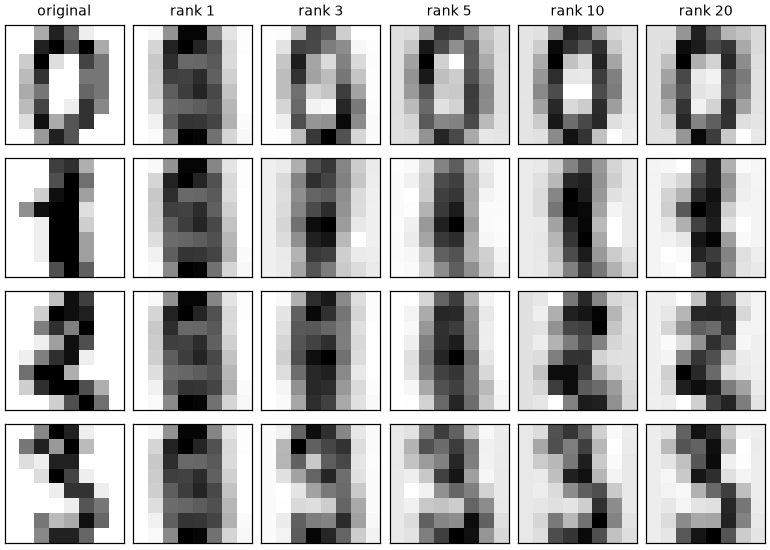

# Linear Algebra for ML

> **Level 0 · Module 2** · Prerequisites: L0-01 · Time: 6 to 8 hours · Code: `code/L0-02-linear-algebra/`

## What you will be able to do

- Compute and interpret dot products, norms, angles and projections, and explain how high-dimensional geometry differs from 2D intuition.
- Read a matrix as a linear map, predict the cost of a chain of products, and choose the cheaper evaluation order.
- Find rank and null space, derive least squares as an orthogonal projection, and explain why ill-conditioning makes weights unstable.
- Compute eigendecompositions and SVDs, implement power iteration, and use the Eckart-Young theorem to build and evaluate low-rank approximations.
- Judge claims about embeddings: when cosine similarity, dot product or distance is the right measure, and when cosine similarity misleads.

## 1. Vectors, dot products and norms

A **vector** in $\mathbb{R}^d$ is an ordered list of $d$ real numbers. ML uses vectors for nearly everything: a row of features, the pixels of an image, a 768-dimensional text embedding, a model's parameters. Linear algebra lets you reason about all of them geometrically, as arrows in a space, even when $d$ is far too large to picture. Notation for this module: lowercase letters are column vectors, uppercase letters are matrices, $x^\top$ is the transpose, and in code a batch of $n$ vectors is the rows of an `(n, d)` array.

A **linear combination** $a_1 v_1 + \dots + a_k v_k$ scales and adds vectors; the set of all of them is the **span**. Vectors are **linearly independent** if none is a combination of the others. "Can the target be predicted as a weighted sum of these features?" is the question "is $y$ in the span of the feature columns?"

The **dot product** and the **Euclidean (L2) norm** are

$$u \cdot v = u^\top v = \sum_{i=1}^{d} u_i v_i, \qquad \lVert u \rVert_2 = \sqrt{u \cdot u}.$$

Two other norms are common: $\lVert u \rVert_1 = \sum_i |u_i|$ and $\lVert u \rVert_\infty = \max_i |u_i|$. Geometrically, $u \cdot v = \lVert u \rVert \lVert v \rVert \cos\theta$, where $\theta$ is the angle between the vectors, so the **cosine similarity** $\cos(u, v) = u \cdot v / (\lVert u \rVert \lVert v \rVert)$ measures direction and ignores length. Since $|\cos\theta| \le 1$, the **Cauchy-Schwarz inequality** $|u \cdot v| \le \lVert u \rVert \lVert v \rVert$ follows.

Worked example (script 01): $u = (3, 4)$, $v = (4, 3)$. Then $u \cdot v = 24$, $\lVert u \rVert_2 = 5$, $\lVert u \rVert_1 = 7$, $\lVert u \rVert_\infty = 4$, and $\cos(u, v) = 24/25 = 0.96$, about 16 degrees. The vector $w = (-4, 3)$ has $u \cdot w = 0$: it is **orthogonal** to $u$.

**Projection.** The part of $u$ along the direction of $v$ is

$$\mathrm{proj}_v(u) = \frac{u \cdot v}{v \cdot v}\, v = \tfrac{24}{25}(4, 3) = (3.84, 2.88),$$

and the residual $u - \mathrm{proj}_v(u) = (-0.84, 1.12)$ is orthogonal to $v$. Section 4 generalizes "project onto a line" to "project onto the span of many columns", and that is least squares.

**Norms in ML.** The squared L2 norm measures error (MSE) and penalizes weights in ridge regression and weight decay. The L1 norm penalizes weights in the lasso. In 2D, the L1 unit ball is a diamond whose corners sit on the axes, which is the geometric reason L1 penalties push some weights exactly to zero (L1-02).

## 2. Geometry in high dimensions

Script 01 draws 500 random Gaussian vectors in $d$ dimensions:

| $d$ | mean $\lvert\cos\rvert$ between pairs | std of cos | farthest / nearest distance to a query |
|---|---|---|---|
| 2 | 0.637 | 0.707 | 75.6 |
| 100 | 0.080 | 0.100 | 1.50 |
| 10,000 | 0.008 | 0.010 | 1.034 |

Random directions become **nearly orthogonal**: the cosine between two random vectors has standard deviation close to $1/\sqrt{d}$. And distances **concentrate**: in 10,000 dimensions, the farthest of 500 random points is only 3.4% farther from a query than the nearest. Two consequences. A cosine of 0.2 means much more in 1,000 dimensions (over six standard deviations from random) than in 10. And nearest-neighbor search works on real data only because real data has far more structure than independent noise, often lying near lower-dimensional subspaces, which section 6 exploits.

## 3. Matrices as linear maps, and what they cost

An $m \times n$ matrix $A$ defines a function $x \mapsto Ax$ from $\mathbb{R}^n$ to $\mathbb{R}^m$ that is **linear**: $A(au + bv) = aAu + bAv$. So $A$ is determined by what it does to the basis vectors $e_1, \dots, e_n$, and $Ae_j$ is column $j$. **The columns are where the basis vectors land**, and

$$Ax = x_1\, \text{col}_1(A) + \dots + x_n\, \text{col}_n(A).$$

3Blue1Brown's "Essence of linear algebra" animates this view, and it is the fastest way to build the intuition [3Blue1Brown, 2016].

Examples from script 02: the 90-degree rotation $R = \begin{pmatrix} 0 & -1 \\ 1 & 0 \end{pmatrix}$ sends $e_1$ to $(0, 1)$; $S = \mathrm{diag}(3, 0.5)$ stretches $x$ and squashes $y$. **Composition is multiplication**: $(RS)x = R(Sx)$ applies $S$ first. Order matters: $RSx = (-0.5, 3)$ but $SRx = (-3, 0.5)$. The **determinant** is the factor by which a square matrix scales signed area or volume: 1 for the rotation and for a shear, 1.5 for $S$, $-1$ for a reflection (orientation flips), and 0 for a projection onto a line, which collapses a direction and cannot be undone. "Does this map collapse a direction?" returns as rank.

**A linear layer is a matrix.** A layer computes $y = Wx + b$; for a batch stored as rows of $X$, that is `X @ W.T + b`. Without nonlinearities between them, a stack of layers would collapse into a single matrix (L2-01).

**Cost.** For $A \in \mathbb{R}^{m \times k}$ and $B \in \mathbb{R}^{k \times n}$, each of the $mn$ entries of $AB$ is a length-$k$ dot product: $mnk$ multiply-adds, conventionally $2mnk$ floating-point operations (**flops**). Square $n \times n$ matrices cost $2n^3$; a matrix-vector product costs $2mn$. Script 02 measures this with NumPy 2.5.4, which uses OpenBLAS for linear algebra here [NumPy linalg docs], on an Intel Core i7-13700HX:

| $n$ | time, float64 | GFLOP/s float64 | GFLOP/s float32 |
|---|---|---|---|
| 256 | 0.12 ms | 285 | 515 |
| 1024 | 5.02 ms | 428 | 892 |
| 2048 | 53.66 ms | 320 | 852 |

Going from 1024 to 2048 multiplied the time by about 10.7, near the factor of 8 predicted by cubic cost. float32 ran about twice as fast as float64, because vector units process twice as many 4-byte numbers per instruction and half as many bytes move through memory, which is one reason ML uses lower precision (L4-02). Threads matter too: pinned to one thread, the $n = 1024$ product ran at 68.6 GFLOP/s against 449.5 with the default thread pool. A benchmark that does not state its thread count is hard to interpret.

**Order of evaluation.** Products are associative, so $(AB)v = A(Bv)$, but for $n = 2000$ the left form costs $2n^3 \approx 1.6 \times 10^{10}$ flops and the right $4n^2 = 1.6 \times 10^{7}$. Script 02 measured 52.1 ms against 1.54 ms. The measured ratio (about 34x) is far below the flop ratio (1000x), because matrix-vector products are limited by memory bandwidth: each matrix entry is read once and used once. The same "which order?" question drives reverse-mode differentiation (L0-03).

## 4. Rank, null space and least squares

The **column space** of $A$ is the span of its columns, the set of all outputs $Ax$. Its dimension is the **rank**. The **null space** is $\{x : Ax = 0\}$, the inputs the map destroys. For an $m \times n$ matrix, $\mathrm{rank}(A) + \dim(\text{null space}) = n$.

Script 03 uses $B = \begin{pmatrix} 1 & 2 & 3 \\ 2 & 4 & 6 \\ 1 & 0 & 1 \end{pmatrix}$. Row 2 is twice row 1, so the rank is 2 and the null space is spanned by $(-1, -1, 1)/\sqrt 3$ (check: $-1 - 2 + 3 = 0$ and $-1 + 0 + 1 = 0$). Change the 6 to 6.1 and the rank becomes 3. Exact rank is fragile, so software counts singular values above a tolerance (section 6).

Rank matters in ML in two ways. If one feature is a combination of others (Celsius and Fahrenheit, a total and its parts), the data matrix loses rank, and regression has infinitely many equally good weight vectors: add any null-space vector and predictions do not change. And products create **bottlenecks**: $\mathrm{rank}(UV) \le \min(\mathrm{rank}\, U, \mathrm{rank}\, V)$, so a $100 \times 5$ times $5 \times 80$ product has rank 5 (script 03 confirms it).

**Least squares as projection.** Given data $X \in \mathbb{R}^{n \times p}$ and targets $y \in \mathbb{R}^n$, find $w$ minimizing $\lVert Xw - y \rVert^2$. As $w$ varies, $Xw$ sweeps the column space of $X$. The closest point to $y$ is its orthogonal projection $\hat y$, so the residual $y - X\hat w$ must be orthogonal to every column, exactly as in section 1:

$$X^\top (y - X\hat{w}) = 0 \;\Longrightarrow\; X^\top X\, \hat{w} = X^\top y, \qquad \hat y = P y, \quad P = X (X^\top X)^{-1} X^\top.$$

These are the **normal equations**. The projection matrix $P$ is symmetric, satisfies $P^2 = P$ (projecting twice changes nothing), has trace equal to the rank of $X$, and splits $\lVert y \rVert^2 = \lVert \hat y \rVert^2 + \lVert y - \hat y \rVert^2$. Script 03 checks all four. Calculus gives the same equations (L0-03, L1-02).

**Conditioning.** The **condition number** $\kappa(X)$, the ratio of largest to smallest singular value, bounds how much relative errors in the data can be amplified in the solution, and forming $X^\top X$ squares it. In script 03, adding a near-copy of a feature raises $\kappa$ from 12.6 to $1.3 \times 10^7$, and to $1.8 \times 10^{14}$ for $X^\top X$, near the limit of float64. The fitted weights become about $\pm 21{,}000$, two huge values nearly cancelling, and a $10^{-3}$ change in $y$ moves them by about 50, while the fitted values move by $1.5 \times 10^{-4}$. The predictions are fine; the individual coefficients mean nothing. Hence ridge regression, which adds $\lambda I$ to $X^\top X$, stabilizes them (L1-02). Solve with `np.linalg.lstsq` or a QR factorization, which work on $X$ directly, not by inverting $X^\top X$.

## 5. Eigenvalues and eigenvectors

A nonzero $q$ is an **eigenvector** of square $A$ with **eigenvalue** $\lambda$ if $Aq = \lambda q$: the map only stretches $q$. For $A = \begin{pmatrix} 2 & 1 \\ 1 & 2 \end{pmatrix}$, $A(1, 1) = (3, 3)$, so $\lambda = 3$, and $A(-1, 1) = (-1, 1)$, so $\lambda = 1$.

**Symmetric matrices are the important case.** Covariance matrices, $X^\top X$, kernel matrices and Hessians are all symmetric. The **spectral theorem** says a real symmetric matrix has real eigenvalues and orthonormal eigenvectors:

$$A = Q \Lambda Q^\top, \qquad Q^\top Q = I,\ \Lambda \text{ diagonal}.$$

In the right coordinates, a symmetric matrix just scales each axis, and $A^k = Q \Lambda^k Q^\top$. Use `np.linalg.eigh` for symmetric matrices; it returns real eigenvalues in ascending order [NumPy linalg docs]. `np.linalg.eig` handles general matrices and, as script 04 shows, returns a complex dtype and unsorted values even when the eigenvalues are real.

**Power iteration.** Repeatedly apply $A$ and renormalize. Writing the start vector in the eigenbasis, component $i$ gets multiplied by $\lambda_i^k$ after $k$ steps, so the largest $|\lambda|$ wins and the error shrinks like $|\lambda_2/\lambda_1|^k$. In script 04, a $200 \times 200$ matrix with $\lambda_2/\lambda_1 = 0.972$ gives an estimate of 3.427 after 10 steps and the true 3.912468 after 200.

**Where eigenvectors appear in ML.**

- **Variance directions.** Eigenvectors of a covariance matrix point along directions of greatest spread, and each eigenvalue is the variance along its eigenvector. In script 04 the top eigenvalue is 3.623, and the variance of the data projected on its eigenvector is exactly 3.623. PCA is built on this (L1-04).
- **Optimization.** Near a minimum, a loss is roughly quadratic with curvature given by the Hessian's eigenvalues. A large ratio between them, bad conditioning again, makes gradient descent zig-zag (L0-05).
- **Markov chains.** For a transition matrix $T$ with rows summing to 1, the long-run distribution satisfies $\pi T = \pi$, a left eigenvector with eigenvalue 1. Script 04 finds $\pi = (0.6364, 0.2727, 0.0909) = (7, 3, 1)/11$.

Non-symmetric matrices may lack real eigenvectors (a 90-degree rotation has eigenvalues $\pm i$); the SVD exists for every matrix.

## 6. The SVD and low-rank approximation

Every real $m \times n$ matrix has a **singular value decomposition**

$$A = U \Sigma V^\top = \sum_{i=1}^{r} \sigma_i\, u_i v_i^\top,$$

with $U$ and $V$ orthogonal, **singular values** $\sigma_1 \ge \sigma_2 \ge \dots \ge 0$ on the diagonal of $\Sigma$, and $r$ the rank. Geometrically, any linear map is a rotation or reflection, then axis scaling, then another rotation or reflection. The sum form writes $A$ as rank-1 pieces in order of importance. Because $A A^\top = U \Sigma^2 U^\top$, the $\sigma_i$ are square roots of the eigenvalues of $AA^\top$. Worked example (script 05): $A = \begin{pmatrix} 3 & 1 & 1 \\ -1 & 3 & 1 \end{pmatrix}$ gives $AA^\top = \begin{pmatrix} 11 & 1 \\ 1 & 11 \end{pmatrix}$ with eigenvalues 12 and 10, so $\sigma = (\sqrt{12}, \sqrt{10}) \approx (3.464, 3.162)$.

Singular values give two standard norms: the **spectral norm** $\lVert A \rVert_2 = \sigma_1$ (the largest stretch of any unit vector) and the **Frobenius norm** $\lVert A \rVert_F = \sqrt{\sum_{ij} A_{ij}^2} = \sqrt{\sum_i \sigma_i^2}$. The condition number in section 4 is $\sigma_1/\sigma_{\min}$.

**Eckart-Young.** Keep the top $k$ terms, $A_k = \sum_{i \le k} \sigma_i u_i v_i^\top$. Eckart and Young (1936) proved that $A_k$ is the best rank-$k$ approximation in the least-squares sense, with

$$\lVert A - A_k \rVert_F = \sqrt{\sigma_{k+1}^2 + \dots + \sigma_r^2}$$

[Eckart and Young, 1936]. Script 05 confirms the formula (350.5159 both ways) and tries 200 random rank-5 subspaces, each used optimally: the best reaches 505.4. Nothing of rank $k$ beats the truncated SVD.

**A real example.** The scikit-learn digits data is a $1797 \times 64$ matrix of 8 by 8 handwritten digits. Its numerical rank is 61, not 64: three pixel positions (0, 32 and 39) are zero in every image, and the last three singular values are about $10^{-13}$, pure rounding noise. A rank-$k$ approximation stores $k(m + n + 1)$ numbers instead of $mn = 115{,}008$:

| $k$ | relative error $\lVert X - X_k\rVert_F / \lVert X \rVert_F$ | fraction of $\sum \sigma_i^2$ kept | numbers stored |
|---|---|---|---|
| 1 | 0.551 | 0.696 | 1,862 |
| 5 | 0.389 | 0.849 | 9,310 |
| 10 | 0.289 | 0.916 | 18,620 |
| 20 | 0.182 | 0.967 | 37,240 |



The first singular value (2193, against 567 for the second) reflects the "average blob" all digits share, so the rank-1 images look alike. By rank 10 the digits are recognizable. This SVD used raw pixels; centering the data first gives PCA (L1-04).

**Low rank in modern ML.** A $d \times d$ matrix stored as two factors of shape $d \times r$ and $r \times d$ needs $2dr$ numbers instead of $d^2$: for $d = 4096$, $r = 8$, that is 65,536 instead of 16.8 million, 256 times fewer. LoRA fine-tunes large language models this way, freezing the pretrained weights and training added low-rank decomposition matrices; its authors report a 10,000-fold reduction in trainable parameters relative to full fine-tuning of GPT-3 175B [Hu et al., 2021]. Whether a low rank suffices is an empirical question per task, not a theorem.

## 7. The geometry of embeddings

An **embedding** maps discrete items (words, products, users) to vectors so that useful relationships become geometric (L2-06 covers training them). Similarity is then a dot product, and searching $N$ items is one matrix-vector product.

For unit vectors, $\lVert u - v \rVert^2 = 2 - 2\cos(u, v)$, so cosine and Euclidean distance give the same ranking, which is why many systems normalize once and then use dot products. Without normalization the measures disagree. If a model was trained to score with raw dot products, as many retrieval and recommendation models are, the norm may carry real information such as popularity.

Script 06 builds synthetic embeddings: 4 topics of 50 items in 64 dimensions, with noise and norms varying from 0.5 to 3, and asks whether each item's 5 nearest neighbors share its topic:

| embeddings | dot product | cosine | mean cosine between items |
|---|---|---|---|
| isotropic | 0.846 | 0.912 | 0.031 |
| plus a shared offset vector | 0.616 | 0.799 | 0.594 |
| shared offset, mean removed | 0.867 | 0.902 | -0.002 |

Here norms carry no topic information, so the dot product's preference for long vectors hurts, and cosine does better. A shared offset (a crude model of **anisotropy**, embeddings crowding into a narrow cone) raises the average cosine between unrelated items from 0.03 to 0.59 and hurts both measures; subtracting the mean embedding undoes most of the damage. The real phenomenon is documented: Ethayarajh (2019) found the contextual representations of ELMo, BERT and GPT-2 are not isotropic in any layer [Ethayarajh, 2019]. So a raw cosine like 0.6 means little alone; compare it with the typical cosine between random pairs from the same model.

**Cosine similarity can be arbitrary.** Steck, Ekanadham and Kallus (2024) show that for embeddings from some regularized linear models, item-item cosine similarities are not uniquely determined by the model, and they caution against using them blindly [Steck et al., 2024]. Script 06 shows the mechanism. If a model only uses dot products between item vectors $u$ and user vectors $v$, then for any positive diagonal $D$, the vectors $uD$ and $vD^{-1}$ give identical dot products and identical predictions, yet the item-item cosines change, here from $(0.143, 0.219, 0.392, 0.047)$ to $(-0.118, 0.189, 0.325, -0.161)$. How much this affects a given deep model depends on its training, and it is still being discussed.

**Analogies as offsets.** Mikolov, Yih and Zweig (2013) reported that in learned word vectors, many relations are roughly constant offsets, so "king" minus "man" plus "woman" lands near "queen" [Mikolov et al., 2013]. Script 06 plants a "plural" offset and recovers "cars" from dogs minus dog plus car. Implementations commonly exclude the input words from the candidates, as the script does (in this toy the answer is the same without the exclusion). The toy works by construction; do not assume real embeddings encode every relation as a clean offset.

## Hands-on

Run each script from the repository root, for example `.venv/bin/python code/L0-02-linear-algebra/01_vectors_norms_dots.py`. Outputs come from Python 3.12.3, NumPy 2.5.4 (OpenBLAS 0.3.34) and scikit-learn 1.9.1 on Linux (WSL2). Random results should match with the same library versions; timings depend on your CPU, threads and load, and eigenvector signs can differ across platforms.

### Script 01: vectors, norms, high dimensions

```python
"""Vectors, dot products, norms, and what happens to angles in high dimensions."""
import numpy as np

rng = np.random.default_rng(0)

# 1. A small worked example.
u = np.array([3.0, 4.0])
v = np.array([4.0, 3.0])
w = np.array([-4.0, 3.0])
print("u.v =", u @ v, "| u.w =", u @ w, "(orthogonal)")
print("||u||_2 =", np.linalg.norm(u), "| ||u||_1 =", np.linalg.norm(u, 1),
      "| ||u||_inf =", np.linalg.norm(u, np.inf))
cos_uv = u @ v / (np.linalg.norm(u) * np.linalg.norm(v))
print(f"cos(u, v) = {cos_uv:.4f} -> angle {np.degrees(np.arccos(cos_uv)):.2f} degrees")

# 2. Projection of u onto the direction of v: the "shadow" of u along v.
proj = (u @ v) / (v @ v) * v
resid = u - proj
print("projection of u onto v:", proj, "| residual:", resid,
      "| residual . v =", round(resid @ v, 12))

# 3. Cauchy-Schwarz |a.b| <= ||a|| ||b||, checked on random pairs.
a = rng.normal(size=(10_000, 50))
b = rng.normal(size=(10_000, 50))
lhs = np.abs((a * b).sum(1))
rhs = np.linalg.norm(a, axis=1) * np.linalg.norm(b, axis=1)
print("\nCauchy-Schwarz holds for all 10,000 pairs:", bool(np.all(lhs <= rhs + 1e-12)))

# 4. High dimensions: random directions are nearly orthogonal, and
#    distances concentrate (nearest and farthest neighbor look alike).
print(f"\n{'dim':>6}{'mean |cos|':>12}{'std cos':>10}{'max/min dist':>14}")
for d in (2, 10, 100, 1000, 10000):
    X = rng.normal(size=(500, d))
    Xn = X / np.linalg.norm(X, axis=1, keepdims=True)
    C = Xn @ Xn.T
    off = C[~np.eye(500, dtype=bool)]
    q = rng.normal(size=d)
    dist = np.linalg.norm(X - q, axis=1)
    print(f"{d:>6}{np.abs(off).mean():>12.4f}{off.std():>10.4f}"
          f"{dist.max() / dist.min():>14.3f}")
print("theory: std of cos between random directions ~ 1/sqrt(d); "
      f"1/sqrt(1000) = {1/np.sqrt(1000):.4f}")
```

```text
u.v = 24.0 | u.w = 0.0 (orthogonal)
||u||_2 = 5.0 | ||u||_1 = 7.0 | ||u||_inf = 4.0
cos(u, v) = 0.9600 -> angle 16.26 degrees
projection of u onto v: [3.84 2.88] | residual: [-0.84  1.12] | residual . v = 0.0

Cauchy-Schwarz holds for all 10,000 pairs: True

   dim  mean |cos|   std cos  max/min dist
     2      0.6366    0.7069        75.555
    10      0.2582    0.3159         3.239
   100      0.0800    0.1000         1.500
  1000      0.0252    0.0316         1.108
 10000      0.0080    0.0100         1.034
theory: std of cos between random directions ~ 1/sqrt(d); 1/sqrt(1000) = 0.0316
```

### Script 02: matrices as maps and the cost of multiplication

```python
"""Matrices as linear maps, composition, and the cost of matrix multiplication."""
import time

import numpy as np

rng = np.random.default_rng(0)

# 1. A matrix is determined by where it sends the basis vectors: its columns.
theta = np.pi / 2
R = np.array([[np.cos(theta), -np.sin(theta)],
              [np.sin(theta),  np.cos(theta)]])    # rotate 90 degrees
S = np.array([[3.0, 0.0],
              [0.0, 0.5]])                          # stretch x, squash y
H = np.array([[1.0, 1.0],
              [0.0, 1.0]])                          # shear
F = np.array([[1.0, 0.0],
              [0.0, -1.0]])                         # reflect across the x-axis
Pj = np.array([[1.0, 0.0],
               [0.0, 0.0]])                         # project onto the x-axis
e1, e2 = np.eye(2)
print("R e1 =", np.round(R @ e1, 3), "= first column of R;",
      "R e2 =", np.round(R @ e2, 3))

# 2. Composition: (R S) x means "apply S first, then R". Order matters.
x = np.array([1.0, 1.0])
print("\nR @ (S @ x) =", np.round(R @ (S @ x), 3), "| (R @ S) @ x =", np.round((R @ S) @ x, 3))
print("S @ R @ x   =", np.round(S @ R @ x, 3), "-> RS != SR:", not np.allclose(R @ S, S @ R))

# 3. Determinant = signed area scaling of the unit square.
#    Negative flips orientation; zero squashes the plane onto a line.
for name, M in [("R", R), ("S", S), ("H", H), ("F", F), ("Pj", Pj), ("S@F", S @ F)]:
    print(f"det({name:<3}) = {np.linalg.det(M):+.3f}")

# 4. Cost: an (m x k) @ (k x n) product needs m*n*k multiply-adds = 2mnk flops.
def gflops(n, dtype=np.float64, reps=10):
    A = rng.normal(size=(n, n)).astype(dtype)
    B = rng.normal(size=(n, n)).astype(dtype)
    for _ in range(3):
        A @ B                                # warm-up (thread pool start, caches)
    best = min(_time(lambda: A @ B) for _ in range(reps))   # best of reps
    return 2 * n**3 / best / 1e9, best


def _time(fn):
    t0 = time.perf_counter()
    fn()
    return time.perf_counter() - t0


print(f"\n{'n':>6}{'time (ms)':>12}{'GFLOP/s f64':>14}{'GFLOP/s f32':>14}")
for n in (256, 1024, 2048):
    g64, t64 = gflops(n)
    g32, _ = gflops(n, np.float32)
    print(f"{n:>6}{t64*1e3:>12.2f}{g64:>14.1f}{g32:>14.1f}")

# BLAS uses many threads by default. Pin to one to see the per-core rate.
try:
    from threadpoolctl import threadpool_limits
    with threadpool_limits(limits=1, user_api="blas"):
        g1, t1 = gflops(1024)
    gall, tall = gflops(1024)
    print(f"n=1024 f64: 1 thread {g1:.1f} GFLOP/s ({t1*1e3:.0f} ms), "
          f"default threads {gall:.1f} GFLOP/s ({tall*1e3:.0f} ms)")
except ImportError:
    print("threadpoolctl not installed; skipping thread comparison")

# 5. Same math, different cost: associativity lets you choose the order.
n = 2000
A = rng.normal(size=(n, n))
B = rng.normal(size=(n, n))
v = rng.normal(size=n)
t_mm = min(_time(lambda: (A @ B) @ v) for _ in range(3))   # ~2n^3 flops
t_mv = min(_time(lambda: A @ (B @ v)) for _ in range(3))   # ~4n^2 flops
print(f"\n(A@B)@v: {t_mm*1e3:.1f} ms   A@(B@v): {t_mv*1e3:.2f} ms   "
      f"same result: {np.allclose((A @ B) @ v, A @ (B @ v))}")
```

```text
R e1 = [0. 1.] = first column of R; R e2 = [-1.  0.]

R @ (S @ x) = [-0.5  3. ] | (R @ S) @ x = [-0.5  3. ]
S @ R @ x   = [-3.   0.5] -> RS != SR: True
det(R  ) = +1.000
det(S  ) = +1.500
det(H  ) = +1.000
det(F  ) = -1.000
det(Pj ) = +0.000
det(S@F) = -1.500

     n   time (ms)   GFLOP/s f64   GFLOP/s f32
   256        0.12         285.2         515.0
  1024        5.02         428.0         892.0
  2048       53.66         320.2         852.2
n=1024 f64: 1 thread 68.6 GFLOP/s (31 ms), default threads 449.5 GFLOP/s (5 ms)

(A@B)@v: 52.1 ms   A@(B@v): 1.54 ms   same result: True
```

The GFLOP/s numbers are the least reproducible output here: on one run with another heavy job on the machine, the $n = 256$ product took 50 ms instead of 0.12 ms.

### Script 03: rank, projections and conditioning

```python
"""Rank, null space, least squares as projection, and conditioning."""
import numpy as np

rng = np.random.default_rng(0)

# 1. Rank = number of independent columns = dimension of the column space.
A = np.array([[1.0, 2.0, 3.0],
              [2.0, 4.0, 6.1],
              [1.0, 0.0, 1.0]])
B = A.copy()
B[1, 2] = 6.0                 # now row 2 = 2 * row 1 exactly
print("rank(A) =", np.linalg.matrix_rank(A), "| rank(B) =", np.linalg.matrix_rank(B))

# Null space of B: directions B sends to zero. From the SVD (see script 05),
# right singular vectors with zero singular value span it.
_, s, Vt = np.linalg.svd(B)
null = Vt[-1]
print("singular values of B:", np.round(s, 6))
print("null vector n =", np.round(null, 4), "| B @ n =", np.round(B @ null, 12))

# 2. Rank of a product never exceeds the smaller rank (a "bottleneck").
U = rng.normal(size=(100, 5))
V = rng.normal(size=(5, 80))
print("\nrank of (100x5)@(5x80) =", np.linalg.matrix_rank(U @ V), "out of max 80")

# 3. Least squares: find w minimizing ||X w - y||^2.
#    Geometrically, X w_hat is the projection of y onto the column space of X.
n = 50
x = rng.uniform(0, 10, size=n)
X = np.column_stack([np.ones(n), x])          # intercept and slope
y = 1.5 + 0.8 * x + rng.normal(scale=1.0, size=n)
w_hat, *_ = np.linalg.lstsq(X, y, rcond=None)
w_normal = np.linalg.solve(X.T @ X, X.T @ y)  # normal equations X^T X w = X^T y
print("\nlstsq w =", np.round(w_hat, 4), "| normal equations w =", np.round(w_normal, 4))

P = X @ np.linalg.inv(X.T @ X) @ X.T          # projection matrix onto col(X)
y_hat = P @ y
r = y - y_hat
print("P is symmetric:", np.allclose(P, P.T), "| P @ P == P:", np.allclose(P @ P, P))
print("residual orthogonal to every column of X: X^T r =", np.round(X.T @ r, 10))
print(f"trace(P) = {np.trace(P):.6f} (= rank of X = number of parameters)")
print(f"Pythagoras: ||y||^2={y@y:.3f} = ||y_hat||^2 + ||r||^2 = {y_hat@y_hat + r@r:.3f}")

# 4. Conditioning: nearly dependent columns make solutions unstable.
x2 = x + rng.normal(scale=1e-6, size=n)       # an almost duplicate feature
Xbad = np.column_stack([np.ones(n), x, x2])
print(f"\ncond(X) = {np.linalg.cond(X):.1f}  cond(Xbad) = {np.linalg.cond(Xbad):.2e}")
print(f"cond(Xbad^T Xbad) = {np.linalg.cond(Xbad.T @ Xbad):.2e}  (squared!)")
w1, *_ = np.linalg.lstsq(Xbad, y, rcond=None)
w2, *_ = np.linalg.lstsq(Xbad, y + rng.normal(scale=1e-3, size=n), rcond=None)
print("weights:                    ", np.round(w1, 2))
print("weights after tiny y change:", np.round(w2, 2))
print("fitted values barely move:  max |change| =",
      f"{np.abs(Xbad @ w1 - Xbad @ w2).max():.2e}")
```

```text
rank(A) = 3 | rank(B) = 2
singular values of B: [8.435449 0.918264 0.      ]
null vector n = [-0.5774 -0.5774  0.5774] | B @ n = [0. 0. 0.]

rank of (100x5)@(5x80) = 5 out of max 80

lstsq w = [1.2062 0.7906] | normal equations w = [1.2062 0.7906]
P is symmetric: True | P @ P == P: True
residual orthogonal to every column of X: X^T r = [0. 0.]
trace(P) = 2.000000 (= rank of X = number of parameters)
Pythagoras: ||y||^2=1622.826 = ||y_hat||^2 + ||r||^2 = 1622.826

cond(X) = 12.6  cond(Xbad) = 1.32e+07
cond(Xbad^T Xbad) = 1.77e+14  (squared!)
weights:                     [ 1.200000e+00 -2.093718e+04  2.093797e+04]
weights after tiny y change: [ 1.200000e+00 -2.098746e+04  2.098825e+04]
fitted values barely move:  max |change| = 1.54e-04
```

### Script 04: eigenvalues, power iteration, Markov chains

```python
"""Eigenvectors: directions a matrix only stretches. Power iteration and uses."""
import numpy as np

rng = np.random.default_rng(0)

# 1. A symmetric 2x2 example by hand: A = [[2,1],[1,2]].
A = np.array([[2.0, 1.0],
              [1.0, 2.0]])
vals, vecs = np.linalg.eigh(A)               # eigh: for symmetric matrices
print("eigenvalues:", vals)
print("eigenvectors (columns):\n", np.round(vecs, 4))
for lam, q in zip(vals, vecs.T):
    print(f"A q = {np.round(A @ q, 4)}  lambda q = {np.round(lam * q, 4)}")
Q, L = vecs, np.diag(vals)
print("A == Q diag(lambda) Q^T:", np.allclose(A, Q @ L @ Q.T),
      "| Q orthogonal:", np.allclose(Q.T @ Q, np.eye(2)))


# 2. Power iteration: repeatedly apply A and renormalize. Converges to the
#    top eigenvector at a rate set by |lambda_2 / lambda_1|.
def power_iteration(M, iters, rng):
    v = rng.normal(size=M.shape[0])
    history = []
    for _ in range(iters):
        v = M @ v
        v /= np.linalg.norm(v)
        history.append(v @ M @ v)            # Rayleigh quotient estimates lambda_1
    return v, history


C = rng.normal(size=(200, 200))
M = C @ C.T / 200                            # symmetric positive semidefinite
true_vals = np.linalg.eigvalsh(M)
v, hist = power_iteration(M, 200, rng)
print(f"\ntop eigenvalue true={true_vals[-1]:.6f}  "
      f"after 10 iters={hist[9]:.6f}  after 200 iters={hist[-1]:.6f}")
print(f"ratio lambda2/lambda1 = {true_vals[-2] / true_vals[-1]:.4f} (closer to 1 = slower)")

# 3. Covariance eigenvectors point along directions of greatest spread.
#    (Centering + this idea is PCA, covered in L1-04.)
cov_true = np.array([[3.0, 1.2],
                     [1.2, 1.0]])
pts = rng.multivariate_normal([0, 0], cov_true, size=5000)
S = np.cov(pts, rowvar=False)
lam, U = np.linalg.eigh(S)
print("\nsample covariance eigenvalues:", np.round(lam, 3))
print("top direction:", np.round(U[:, -1], 3),
      "| variance of data projected on it:", round(float(np.var(pts @ U[:, -1], ddof=1)), 3))

# 4. Markov chain: the stationary distribution is the eigenvector with eigenvalue 1.
T = np.array([[0.9, 0.1, 0.0],               # row-stochastic transition matrix
              [0.2, 0.7, 0.1],
              [0.1, 0.2, 0.7]])
w, V = np.linalg.eig(T.T)                    # left eigenvectors of T
pi = np.real(V[:, np.argmin(np.abs(w - 1))])
pi /= pi.sum()
print("\nstationary distribution:", np.round(pi, 4),
      "| pi T == pi:", np.allclose(pi @ T, pi))
print("eigenvalues of T (eig: complex dtype, unsorted):", np.round(w, 4))
```

```text
eigenvalues: [1. 3.]
eigenvectors (columns):
 [[-0.7071  0.7071]
 [ 0.7071  0.7071]]
A q = [-0.7071  0.7071]  lambda q = [-0.7071  0.7071]
A q = [2.1213 2.1213]  lambda q = [2.1213 2.1213]
A == Q diag(lambda) Q^T: True | Q orthogonal: True

top eigenvalue true=3.912468  after 10 iters=3.427255  after 200 iters=3.912468
ratio lambda2/lambda1 = 0.9724 (closer to 1 = slower)

sample covariance eigenvalues: [0.432 3.623]
top direction: [-0.905 -0.426] | variance of data projected on it: 3.623

stationary distribution: [0.6364 0.2727 0.0909] | pi T == pi: True
eigenvalues of T (eig: complex dtype, unsorted): [0.5382+0.j 1.    +0.j 0.7618+0.j]
```

### Script 05: SVD and low-rank approximation

```python
"""SVD and low-rank approximation, checked against the Eckart-Young theorem.

Run from the repository root so the plot lands in docs/assets/.
"""
from pathlib import Path

import matplotlib
matplotlib.use("Agg")
import matplotlib.pyplot as plt
import numpy as np
from sklearn.datasets import load_digits

rng = np.random.default_rng(0)
OUT = Path("docs/assets/L0-02-linear-algebra")

# 1. SVD of a small matrix: A = U diag(s) V^T.
A = np.array([[3.0, 1.0, 1.0],
              [-1.0, 3.0, 1.0]])
U, s, Vt = np.linalg.svd(A, full_matrices=False)
print("singular values:", np.round(s, 4))
print("reconstruct A:", np.allclose(A, U @ np.diag(s) @ Vt))
print("s^2 == eigenvalues of A A^T:", np.round(s**2, 4), np.round(np.linalg.eigvalsh(A @ A.T)[::-1], 4))
print("||A||_2 (largest stretch) =", round(np.linalg.norm(A, 2), 4),
      "| ||A||_F =", round(np.linalg.norm(A, "fro"), 4),
      "= sqrt(sum s^2) =", round(float(np.sqrt((s**2).sum())), 4))


def rank_k(U, s, Vt, k):
    return (U[:, :k] * s[:k]) @ Vt[:k]       # sum of the top-k rank-1 pieces


# 2. Eckart-Young: truncated SVD is the best rank-k approximation, with
#    Frobenius error sqrt(s_{k+1}^2 + ...). Check against random rank-k guesses.
M = rng.normal(size=(60, 40)) @ np.diag(np.linspace(3, 0.1, 40)) @ rng.normal(size=(40, 40))
Um, sm, Vtm = np.linalg.svd(M, full_matrices=False)
k = 5
err_svd = np.linalg.norm(M - rank_k(Um, sm, Vtm, k), "fro")
print(f"\nrank-{k} SVD error = {err_svd:.4f}; theory sqrt(sum s[k:]^2) = "
      f"{np.sqrt((sm[k:]**2).sum()):.4f}")
best_random = np.inf
for _ in range(200):
    # best possible fit of M using a random k-dim column space (projection)
    Qr, _ = np.linalg.qr(rng.normal(size=(60, k)))
    best_random = min(best_random, np.linalg.norm(M - Qr @ (Qr.T @ M), "fro"))
print(f"best of 200 random rank-{k} subspaces: error = {best_random:.4f}")

# 3. Real data: 8x8 handwritten digits (bundled with scikit-learn), 1797 x 64.
X = load_digits().data                       # pixel values 0..16
Ux, sx, Vtx = np.linalg.svd(X, full_matrices=False)
energy = np.cumsum(sx**2) / np.sum(sx**2)
print(f"\ndigits matrix {X.shape}, numerical rank {np.linalg.matrix_rank(X)}")
print("first 3 singular values:", np.round(sx[:3], 1), "| last 4:", sx[-4:])
print(f"{'k':>4}{'rel. Frobenius error':>22}{'energy kept':>13}{'numbers stored':>16}")
for k in (1, 2, 5, 10, 20, 40):
    rel = np.linalg.norm(X - rank_k(Ux, sx, Vtx, k)) / np.linalg.norm(X)
    stored = k * (X.shape[0] + X.shape[1] + 1)
    print(f"{k:>4}{rel:>22.4f}{energy[k-1]:>13.4f}{stored:>16,}")
print(f"full matrix stores {X.size:,} numbers")

# 4. Plot: original digits and their rank-k reconstructions.
OUT.mkdir(parents=True, exist_ok=True)
ks = [1, 3, 5, 10, 20]
idx = [0, 1, 2, 3]
fig, axes = plt.subplots(len(idx), len(ks) + 1, figsize=(7, 5), layout="constrained")
for row, i in enumerate(idx):
    axes[row, 0].imshow(X[i].reshape(8, 8), cmap="gray_r")
    for col, k in enumerate(ks, start=1):
        rec = rank_k(Ux, sx, Vtx, k)[i]
        axes[row, col].imshow(rec.reshape(8, 8), cmap="gray_r")
for col, title in enumerate(["original"] + [f"rank {k}" for k in ks]):
    axes[0, col].set_title(title, fontsize=9)
for ax in axes.ravel():
    ax.set_xticks([])
    ax.set_yticks([])
fig.savefig(OUT / "digits_low_rank.png", dpi=110)
print(f"saved {OUT / 'digits_low_rank.png'}")
```

```text
singular values: [3.4641 3.1623]
reconstruct A: True
s^2 == eigenvalues of A A^T: [12. 10.] [12. 10.]
||A||_2 (largest stretch) = 3.4641 | ||A||_F = 4.6904 = sqrt(sum s^2) = 4.6904

rank-5 SVD error = 350.5159; theory sqrt(sum s[k:]^2) = 350.5159
best of 200 random rank-5 subspaces: error = 505.3991

digits matrix (1797, 64), numerical rank 61
first 3 singular values: [2193.1  567.   542. ] | last 4: [8.60513674e-01 1.83101880e-13 1.83101880e-13 1.81701891e-13]
   k  rel. Frobenius error  energy kept  numbers stored
   1                0.5510       0.6964           1,862
   2                0.5070       0.7429           3,724
   5                0.3893       0.8485           9,310
  10                0.2892       0.9163          18,620
  20                0.1820       0.9669          37,240
  40                0.0608       0.9963          74,480
full matrix stores 115,008 numbers
saved docs/assets/L0-02-linear-algebra/digits_low_rank.png
```

### Script 06: embedding geometry

```python
"""Embedding geometry: cosine vs dot product, nearest neighbors, and pitfalls.

The embeddings are synthetic so the script needs no downloads: each "item"
is a topic direction plus noise, plus a shared offset that mimics the
common-direction (anisotropy) effect reported for real embeddings.
"""
import numpy as np

rng = np.random.default_rng(0)
d, n_topics, per_topic = 64, 4, 50

# 1. Build embeddings: topic centers + noise + random norms + a shared offset.
centers = rng.normal(size=(n_topics, d))
centers /= np.linalg.norm(centers, axis=1, keepdims=True)
labels = np.repeat(np.arange(n_topics), per_topic)
E = centers[labels] + 2.0 * rng.normal(size=(len(labels), d)) / np.sqrt(d)
E *= rng.uniform(0.5, 3.0, size=(len(labels), 1))       # norms vary (e.g. frequency)
shared = 4.0 * rng.normal(size=d) / np.sqrt(d)          # common direction
E_aniso = E + shared


def normalize(M):
    return M / np.linalg.norm(M, axis=1, keepdims=True)


def knn_topic_accuracy(S, labels, k=5):
    """Fraction of each item's k nearest neighbors (by score S) in the same topic."""
    S = S.copy()
    np.fill_diagonal(S, -np.inf)                         # exclude self
    nn = np.argsort(-S, axis=1)[:, :k]
    return np.mean(labels[nn] == labels[:, None])


def mean_offdiag_cos(M):
    C = normalize(M) @ normalize(M).T
    return C[~np.eye(len(M), dtype=bool)].mean()


# 2. Dot product rewards large norms; cosine ignores them.
print(f"{'embeddings':<22}{'score':<8}{'kNN same-topic':>15}{'mean cos':>10}")
for name, M in [("isotropic", E), ("with shared offset", E_aniso),
                ("offset, mean-removed", E_aniso - E_aniso.mean(0))]:
    for score, S in [("dot", M @ M.T), ("cosine", normalize(M) @ normalize(M).T)]:
        print(f"{name:<22}{score:<8}{knn_topic_accuracy(S, labels):>15.3f}"
              f"{mean_offdiag_cos(M):>10.3f}")

# 3. Nearest-neighbor search is one matrix multiply on normalized vectors.
query = E[0] + 0.05 * rng.normal(size=d)
scores = normalize(E) @ (query / np.linalg.norm(query))
top = np.argsort(-scores)[:5]
print("\nquery is a noisy copy of item 0 (topic 0)")
print("top-5 items:", top, "topics:", labels[top], "cos:", np.round(scores[top], 3))

# 4. Cosine similarity is not invariant to per-dimension rescaling.
#    If a model only uses dot products u.v, then (u D) . (v D^-1) = u.v for
#    any positive diagonal D: the model's predictions are unchanged, but the
#    cosine similarities among the u's change. This is the core of the
#    argument in Steck et al. (2024).
D = np.exp(rng.normal(scale=1.0, size=d))
U_items = E[:5]
V_users = rng.normal(size=(3, d))
print("\nuser-item dot products identical after rescaling:",
      np.allclose(U_items @ V_users.T, (U_items * D) @ (V_users / D).T))
c_before = normalize(U_items) @ normalize(U_items).T
c_after = normalize(U_items * D) @ normalize(U_items * D).T
print("item-item cosine before:", np.round(c_before[0, 1:], 3))
print("item-item cosine after: ", np.round(c_after[0, 1:], 3))

# 5. Analogy arithmetic works when relations are consistent vector offsets.
#    We plant one: "plural" = a fixed offset vector.
base = normalize(rng.normal(size=(5, d)))
plural = 0.8 * normalize(rng.normal(size=(1, d)))[0]
vocab = np.vstack([base, base + plural + 0.05 * rng.normal(size=(5, d))])
names = ["cat", "dog", "car", "tree", "cup", "cats", "dogs", "cars", "trees", "cups"]
target = vocab[names.index("dogs")] - vocab[names.index("dog")] + vocab[names.index("car")]
sims = normalize(vocab) @ (target / np.linalg.norm(target))
for w in ("dogs", "dog", "car"):             # standard practice: exclude inputs
    sims[names.index(w)] = -np.inf
print("\ndogs - dog + car ->", names[int(np.argmax(sims))])
```

```text
embeddings            score    kNN same-topic  mean cos
isotropic             dot               0.846     0.031
isotropic             cosine            0.912     0.031
with shared offset    dot               0.616     0.594
with shared offset    cosine            0.799     0.594
offset, mean-removed  dot               0.867    -0.002
offset, mean-removed  cosine            0.902    -0.002

query is a noisy copy of item 0 (topic 0)
top-5 items: [ 0 34  3 25 44] topics: [0 0 0 0 0] cos: [0.997 0.423 0.396 0.394 0.391]

user-item dot products identical after rescaling: True
item-item cosine before: [0.143 0.219 0.392 0.047]
item-item cosine after:  [-0.118  0.189  0.325 -0.161]

dogs - dog + car -> cars
```

## Common mistakes

- **`*` versus `@`.** `A * B` is elementwise; `A @ B` is the matrix product. On square matrices both run and give different answers.
- **Row versus column conventions.** Math writes $Wx$; code with batches as rows writes `X @ W.T`. Write the shape next to every symbol when porting an equation.
- **Inverting to solve.** `np.linalg.inv(A) @ b` is slower and less accurate than `np.linalg.solve(A, b)`; inverting $X^\top X$ squares the condition number.
- **Judging singularity by the determinant.** $0.1 I_{100}$ has determinant $10^{-100}$ and is perfectly conditioned. Look at singular values.
- **`eig` on symmetric matrices.** Use `eigh`: real output, sorted, faster to reason about.
- **Comparing eigenvectors or singular vectors directly.** Signs are arbitrary and can flip between runs or versions. Compare $|q|$ or subspaces.
- **Reading coefficients under collinearity.** Huge opposite-signed weights are a conditioning symptom, not a finding.
- **Treating cosine values as calibrated.** Their scale depends on dimension, anisotropy and training. Compare with a baseline.

## Exercises

1. [warm-up] For $u = (1, 2, 2)$ and $v = (2, 0, 1)$, compute by hand $u \cdot v$, $\lVert u \rVert_2$, $\lVert v \rVert_1$, $\cos(u, v)$ and $\mathrm{proj}_v(u)$. Check with NumPy.
2. [warm-up] Write the matrix that reflects across the line $y = x$. Give its determinant, eigenvalues and eigenvectors.
3. [warm-up] With $A$ of shape $(1000, 10)$, $B$ of shape $(10, 1000)$, $C$ of shape $(1000, 1000)$, give the flop counts of $(AB)C$ and $A(BC)$.
4. [core] Build a $5 \times 4$ integer matrix of rank 2. Verify the rank, get a null-space basis from the SVD, and show that adding a null-space vector to $x$ leaves $Ax$ unchanged.
5. [core] Fit a line with intercept to 20 random points using `lstsq`, the normal equations, and the SVD pseudo-inverse $V \Sigma^{-1} U^\top y$. Confirm they agree and that $X^\top r \approx 0$.
6. [core] Adapt power iteration to find the smallest eigenvalue of a symmetric positive definite matrix. What sets the convergence rate now?
7. [core] On the digits matrix, find the smallest $k$ keeping 95% of $\sum \sigma_i^2$, before and after centering the columns. Explain the difference.
8. [stretch] Show that for unit vectors $\lVert u - v \rVert^2 = 2 - 2\cos(u, v)$. Then build three unnormalized candidate vectors where the nearest neighbor of a query differs under dot product, cosine and Euclidean distance.
9. [stretch] Prove $\kappa(X^\top X) = \kappa(X)^2$ with the SVD, and measure how many digits of $\hat w$ the normal equations lose against `lstsq` on the near-duplicate feature of script 03.
10. [stretch] Implement a randomized low-rank approximation: multiply $X$ by a random $64 \times (k + 10)$ Gaussian matrix, orthonormalize with QR to get $Q$, take the SVD of $Q^\top X$. Compare with the exact truncated SVD on the digits for $k = 10$.

### Hints and answers

1. $u \cdot v = 4$, $\lVert u \rVert_2 = 3$, $\lVert v \rVert_1 = 3$, $\cos = 4/(3\sqrt 5) \approx 0.596$, $\mathrm{proj}_v(u) = \tfrac45 (2, 0, 1) = (1.6, 0, 0.8)$.
2. $\begin{pmatrix} 0 & 1 \\ 1 & 0 \end{pmatrix}$; determinant $-1$; eigenvalue 1 for $(1, 1)$, $-1$ for $(1, -1)$.
3. $(AB)C$: $2 \times 10^7 + 2 \times 10^9$. $A(BC)$: $2 \times 10^7 + 2 \times 10^7$. About 50 times less.
4. Make three rows combinations of two independent ones. The null space is spanned by the last two rows of `Vt`.
5. Use `np.linalg.svd(X, full_matrices=False)`. Expect `X.T @ r` around $10^{-13}$ or smaller.
6. Run power iteration on $A^{-1}$ (call `solve` each step, never form the inverse) or on $cI - A$ with $c > \lambda_{\max}$. For $A^{-1}$ the rate is $\lambda_{\min}/\lambda_{\text{2nd smallest}}$.
7. A test run gave $k = 16$ raw and $k = 29$ centered. Uncentered, the first component mostly encodes the mean image (69.6% of $\sum\sigma_i^2$ alone, against 14.9% after centering), which says nothing about how digits differ. This is why PCA centers (L1-04).
8. Expand $(u - v)\cdot(u - v)$. Give one candidate a large norm and a wider angle, one a small norm and a tiny angle, one a close position.
9. $X^\top X = V \Sigma^2 V^\top$. With $\kappa(X) \approx 10^7$, expect to lose roughly 14 of float64's 16 digits.
10. In a test run (seed 0), the plain range finder's error was about 16% above the exact SVD. One power iteration ($Y \leftarrow X X^\top Y$ before QR) brought it within 0.3%.

## Check your understanding

1. **Why do a matrix's columns tell you what it does?** Any $x$ is $\sum_j x_j e_j$, and linearity gives $Ax = \sum_j x_j A e_j$, where $Ae_j$ is column $j$. So every output is a combination of the columns, the column space is everything the map can produce, and rank, invertibility and a linear layer's behavior follow from that.

2. **A regression fits well, but two coefficients are $+21{,}000$ and $-21{,}000$. What happened?** Two features are nearly collinear, so $X$ is ill-conditioned: very different weight vectors give nearly the same predictions, and noise picks among them. Predictions and the sum of the two weights are stable, but each coefficient is meaningless. Drop or combine features, or add ridge regularization.

3. **What does Eckart-Young guarantee, and what not?** The truncated SVD is the closest rank-$k$ matrix in Frobenius (and spectral) norm, with error read off the discarded singular values. It does not say rank $k$ is enough for your task, that singular vectors are interpretable, or that low reconstruction error preserves what a downstream model needs. The digits keep 92% of $\sum\sigma_i^2$ at rank 10 and still look blurred.

4. **When prefer cosine over dot product?** Prefer cosine when length means nothing for the question or the model was trained on normalized vectors, since length then only adds noise. Prefer the dot product when the model scores with dot products and length encodes something real. Either way, compare against a baseline, because anisotropy inflates similarities, and for some models cosine values are not uniquely determined.

5. **Why do symmetric matrices get special treatment?** They have real eigenvalues and orthonormal eigenvectors, so they are pure scalings along perpendicular axes, and powers, inverses and square roots act on the eigenvalues alone. They arise as covariances, Gram and kernel matrices, $X^\top X$ and Hessians.

## Further reading

- **Gilbert Strang, "18.06 Linear Algebra"** (Spring 2010, MIT OpenCourseWare). https://ocw.mit.edu/courses/18-06-linear-algebra-spring-2010/
  *Read for:* complete video lectures, problem sets and exams for a classic first course, covering this module in more depth. Free, CC BY-NC-SA. *Level:* intro.
- **Grant Sanderson (3Blue1Brown), "Essence of linear algebra"** (2016, video series). https://www.3blue1brown.com/lessons/eola-preview
  *Read for:* animated intuition for linear maps, determinants and eigenvectors; watch before or alongside this module. *Level:* intro.
- **Stephen Boyd and Lieven Vandenberghe, "Introduction to Applied Linear Algebra: Vectors, Matrices, and Least Squares"** (2018, Cambridge University Press). https://web.stanford.edu/~boyd/vmls/
  *Read for:* an applied, data-oriented treatment of vectors, matrices and least squares that assumes little background. Free PDF. *Level:* intro.
- **Marc Peter Deisenroth, A. Aldo Faisal, Cheng Soon Ong, "Mathematics for Machine Learning"** (2020, Cambridge University Press). https://mml-book.github.io/
  *Read for:* chapters 2 to 4 (linear algebra, analytic geometry, matrix decompositions), written to prepare for ML. Free PDF. *Level:* intro to intermediate.
- **NumPy Developers, "Linear algebra (numpy.linalg)"** (NumPy v2.5 reference, accessed October 2026). https://numpy.org/doc/stable/reference/routines.linalg.html
  *Read for:* the functions used here, the `@` operator, and the note that NumPy relies on BLAS and LAPACK, whose threading may need control. The linked `eigh` page documents real eigenvalues in ascending order. *Level:* intro.
- **Carl Eckart and Gale Young, "The approximation of one matrix by another of lower rank"** (1936, Psychometrika 1(3), 211 to 218). https://doi.org/10.1007/BF02288367
  *Read for:* the original optimality result for truncated SVD. Publisher version may be paywalled. *Level:* advanced.
- **Edward J. Hu, Yelong Shen, Phillip Wallis, Zeyuan Allen-Zhu, Yuanzhi Li, Shean Wang, Lu Wang, Weizhu Chen, "LoRA: Low-Rank Adaptation of Large Language Models"** (2021, arXiv:2106.09685). https://arxiv.org/abs/2106.09685
  *Read for:* low-rank factorized weight updates for cheap fine-tuning, a direct application of section 6. *Level:* intermediate.
- **Tomas Mikolov, Wen-tau Yih, Geoffrey Zweig, "Linguistic Regularities in Continuous Space Word Representations"** (2013, NAACL-HLT, 746 to 751). https://aclanthology.org/N13-1090/
  *Read for:* the vector-offset view of analogies and how it was evaluated. Open access. *Level:* intermediate.
- **Kawin Ethayarajh, "How Contextual are Contextualized Word Representations? Comparing the Geometry of BERT, ELMo, and GPT-2 Embeddings"** (2019, EMNLP; arXiv:1909.00512). https://arxiv.org/abs/1909.00512
  *Read for:* cosine-based evidence that contextual embeddings are anisotropic in every layer. *Level:* intermediate to advanced.
- **Harald Steck, Chaitanya Ekanadham, Nathan Kallus, "Is Cosine-Similarity of Embeddings Really About Similarity?"** (2024, ACM Web Conference 2024 Companion; arXiv:2403.05440). https://arxiv.org/abs/2403.05440
  *Read for:* why cosine similarities of learned embeddings can be arbitrary, including the rescaling argument in script 06. *Level:* intermediate.
